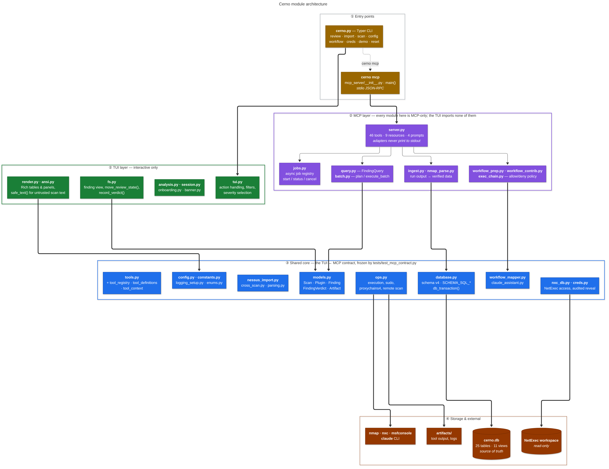

# Cerno Architecture

How the code is organized, which layer owns what, and where the boundaries are
that you should not casually cross.

For the user-facing picture of what Cerno *does*, see
[How It Works](../README.md#how-it-works). For the schema, see
[docs/DATABASE.md](DATABASE.md). For the MCP surface, see [docs/MCP.md](MCP.md).

---

## The layered view

<p align="center">
  <picture>
    <source media="(prefers-color-scheme: dark)" srcset="images/diagrams/02-architecture-dark.png">
    
  </picture>
</p>

<sub>Source: [docs/diagrams/02-architecture.mmd](diagrams/02-architecture.mmd) — regenerate with
<code>./scripts/render_diagrams.sh</code>.</sub>

---

## ① Entry points

| Entry point | Module | Notes |
|---|---|---|
| `cerno <command>` | [cerno.py](../cerno.py) | Typer app: `review`, `import`, `scan`, `config`, `workflow`, `creds`, `demo`, `reset` |
| `cerno mcp` | [cerno_pkg/mcp_server/\_\_init\_\_.py](../cerno_pkg/mcp_server/__init__.py) | `build_server()` / `main()`, stdio JSON-RPC |

`cerno.py` also owns the top-level navigation loops (`browse_file_list`,
`browse_workflow_groups`, `browse_claude_chat`) rather than delegating them to
`tui.py` — worth knowing when you go looking for where a screen is driven from.

## ② Interface layers

### TUI — interactive only

| Module | Owns |
|---|---|
| [tui.py](../cerno_pkg/tui.py) | Findings-list action handling, name/group/status filters, severity selection |
| [fs.py](../cerno_pkg/fs.py) | Finding view, `move_review_state()`, `record_verdict()`, page size |
| [render.py](../cerno_pkg/render.py) · [ansi.py](../cerno_pkg/ansi.py) | All Rich rendering; `safe_text()` / `print_verbatim()` for untrusted scan text |
| [analysis.py](../cerno_pkg/analysis.py) · [session.py](../cerno_pkg/session.py) | Host:port group analysis (`[H]`/`[O]`), session persistence |
| [onboarding.py](../cerno_pkg/onboarding.py) · [banner.py](../cerno_pkg/banner.py) | First-run tour, startup banner |

These modules prompt, print and assume a terminal. **Nothing in the MCP layer may
import them.**

### MCP — `cerno mcp`

| Module | Owns |
|---|---|
| [mcp_server/server.py](../cerno_pkg/mcp_server/server.py) | Pure `tool_*` / `resource_*` / `prompt_*` adapters + `MCPServer` registration |
| [mcp_server/jobs.py](../cerno_pkg/mcp_server/jobs.py) | In-memory async job registry (start/status/cancel/list, `killpg` cancellation) |
| [query.py](../cerno_pkg/query.py) · [batch.py](../cerno_pkg/batch.py) | `FindingQuery` predicates; `plan_batch` dry run and `execute_batch` fan-out |
| [ingest.py](../cerno_pkg/ingest.py) · [nmap_parse.py](../cerno_pkg/nmap_parse.py) | Run output → `verified_ports` / `nse_script_results` / `nxc_flag_observations` |
| [workflow_prep.py](../cerno_pkg/workflow_prep.py) · [workflow_contrib.py](../cerno_pkg/workflow_contrib.py) | Placeholder filling; sanitized workflow contribution |
| [exec_chain.py](../cerno_pkg/exec_chain.py) | Wrapper unwrapping and allow/deny glob matching |

> **These are MCP-only today.** The TUI imports none of them. If you are adding a
> feature that both interfaces need, it belongs in the shared core, not here —
> and moving a module out of this tier is a deliberate change, not a refactor
> side effect.

Two rules apply to everything in this tier:

- **stdout is the JSON-RPC channel.** Never `print()`. Use the `log_*` helpers and
  run commands through `ops.run_command_captured` — no Rich spinners, no prompts.
- **Capability gates are config, not code paths.** `mcp_allow_execution`,
  `mcp_allow_mutations`, `mcp_allow_batch`, `mcp_allow_cred_injection` and
  `mcp_allow_cred_reveal` decide which tools are even *registered*. See
  [docs/MCP.md](MCP.md).

## ③ Shared core — the contract

Everything both interfaces depend on:

| Module | Owns |
|---|---|
| [models.py](../cerno_pkg/models.py) | `Scan`, `Plugin`, `Finding`, `FindingVerdict`, `Artifact`, lookup models |
| [database.py](../cerno_pkg/database.py) | Connection handling, `SCHEMA_SQL_TABLES` / `SCHEMA_SQL_VIEWS`, `SCHEMA_VERSION`, `db_transaction()` |
| [tools.py](../cerno_pkg/tools.py) + [tool_registry.py](../cerno_pkg/tool_registry.py) · [tool_definitions.py](../cerno_pkg/tool_definitions.py) · [tool_context.py](../cerno_pkg/tool_context.py) | Command builders, workflow builders, the `Tool` registry |
| [ops.py](../cerno_pkg/ops.py) | Command execution, sudo/proxychains4 handling, remote-scan HTTPS server |
| [nessus_import.py](../cerno_pkg/nessus_import.py) · [cross_scan.py](../cerno_pkg/cross_scan.py) · [parsing.py](../cerno_pkg/parsing.py) | XML import, compare/history queries, canonical host:port parsing |
| [nxc_db.py](../cerno_pkg/nxc_db.py) · [creds.py](../cerno_pkg/creds.py) | Read-only NetExec workspace access, audited credential reveal |
| [workflow_mapper.py](../cerno_pkg/workflow_mapper.py) · [claude_assistant.py](../cerno_pkg/claude_assistant.py) | Workflow YAML loading/merging, Claude Assistant context + consent |
| [config.py](../cerno_pkg/config.py) · [constants.py](../cerno_pkg/constants.py) · [logging_setup.py](../cerno_pkg/logging_setup.py) · [enums.py](../cerno_pkg/enums.py) | Configuration, paths, review-state constants, logging |

**This layer is the contract between the two interfaces.** A change to a shared
function's signature, return shape or database-access behavior can break the
interface you were not looking at.
[`tests/test_mcp_contract.py`](../tests/test_mcp_contract.py) is the tripwire: it
freezes the MCP tool/resource/prompt inventory and drives every category through
the real MCP path against a seeded database. When you intentionally change the
MCP surface, update that test's `EXPECTED_*` sets in the same change.

Run the **full** suite before every PR, not just the tests near your change. See
[CONTRIBUTING.md](../CONTRIBUTING.md#the-tui--mcp-shared-core-contract).

## ④ Storage & external

| Target | Role |
|---|---|
| `~/.cerno/cerno.db` | **Source of truth.** 25 tables, 11 views, schema v4. No migration system — an older DB raises `SchemaVersionError` |
| `~/.cerno/artifacts` | Tool output and logs, registered in the `artifacts` table |
| `~/.nxc/workspaces/default` | NetExec workspace, **read-only**. Credentials are surfaced as refs, never duplicated into Cerno's DB |
| `nmap` · `nxc` · `msfconsole` · `claude` | External binaries, all optional |

Import writes **no** per-plugin files — only the database (plus
`scans/<name>/http_urls.txt` when web services exist).

---

## Design rules worth knowing before you change things

**Database is the source of truth.** Review state lives only in
`findings.review_state`; there are no filename prefixes and no session JSON. File
browsing queries the database rather than walking the filesystem.

**Never store derived data.** Counts, durations and aggregates are computed by SQL
views (`v_finding_stats`, `v_session_stats`, …), not cached in columns. See the
normalization rules in [CLAUDE.md](../CLAUDE.md#database-design-principles).

**All scan text is untrusted.** Plugin names, hostnames, workflow step titles and
tool output come from third-party files and must not be handed raw to Rich — a
value containing `[/]` raises `MarkupError`, and one containing a style word is
silently swallowed. Use `rich.text.Text` or `ansi.safe_text()`. Regression tests
live in [tests/test_markup_injection.py](../tests/test_markup_injection.py).

**Data and rendering are separate.** Compute a plain data structure first, then
render it (`analysis.py:build_compare_data()` → `render_compare_table()`). This is
what lets the MCP layer reuse logic that the TUI displays.

**Adding a tool needs no dispatch changes.** Write `build_<tool>_cmd(...)` and
`build_<tool>_workflow(ctx) -> Optional[CommandResult]`, then register a `Tool(...)`
in `tool_definitions.py`. See [docs/ADDING_TOOLS_QUICKSTART.md](ADDING_TOOLS_QUICKSTART.md)
and [docs/TOOL_SYSTEM_GUIDE.md](TOOL_SYSTEM_GUIDE.md).

**New subpackages must be listed in `pyproject.toml`.** Setuptools does not
auto-discover them; omitting one causes `ModuleNotFoundError` in pipx installs.

---

## Regenerating the diagrams

Sources live in [docs/diagrams/](diagrams/) as Mermaid `.mmd` files and are the
thing to edit. Rendering needs Node and a Chromium build:

```bash
./scripts/render_diagrams.sh          # all diagrams, light + dark
./scripts/render_diagrams.sh 02       # just the architecture diagram
```

Each source produces a `-light.png` and a `-dark.png` in
[docs/images/diagrams/](images/diagrams/); the Markdown picks between them with a
`<picture>` element keyed on `prefers-color-scheme`.
