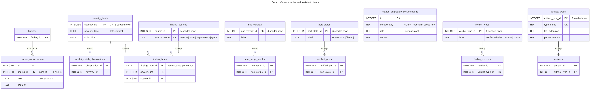
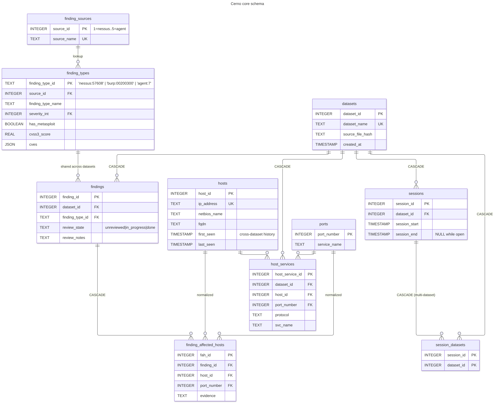

# Cerno Database Documentation

Cerno uses an **integrated SQLite database** with a fully normalized schema for tracking scan metadata, review state, tool executions, and generated artifacts. The database provides an audit trail, enables historical analysis, cross-dataset queries, and maintains referential integrity through foreign key constraints.

---

## Table of Contents

- [Overview](#overview)
- [Database Location](#database-location)
- [Normalized Schema Architecture](#normalized-schema-architecture)
- [Schema Overview](#schema-overview)
- [Foundation Tables](#foundation-tables)
- [Core Tables](#core-tables)
- [SQL Views (Computed Statistics)](#sql-views-computed-statistics)
- [Query Examples](#query-examples)
- [Cross-Dataset Tracking](#cross-dataset-tracking)
- [Schema Reference](#schema-reference)

---

## Overview

The Cerno database tracks:

- **Datasets**: Imported dataset metadata (dataset name, export root, source file hash) — a `.nessus` export or a nuclei results file
- **Finding types**: Vulnerability definitions (finding type ID, name, severity, CVSS scores, CVEs, Metasploit modules)
- **Findings**: Individual vulnerability findings per dataset (review state, append-only review notes)
- **Hosts, Ports & Services**: Normalized host/port data with cross-dataset tracking, plus per-dataset discovered services
- **Sessions**: Review sessions (start/end; duration via SQL view), including the datasets of a multi-dataset session
- **Tool Executions & Artifacts**: Commands run (TUI and MCP), their exit codes, and the files they produced
- **Verification results**: Live-verified open ports, NSE script verdicts, nuclei match observations and NetExec flag snapshots ingested from tool runs
- **Verdicts**: Append-only verification verdicts per finding, with links to the evidence that supports them
- **Claude Assistant history**: Per-finding and scope-level chat turns

All operations work **transparently** - no manual database management required.

---

## Database Location

**Default Path**: `~/.cerno/cerno.db`

The database is global across all datasets, enabling cross-dataset queries and historical analysis.

**Directory**: `~/.cerno/` is created automatically on first use.

**Schema Version**: 5, stored in `PRAGMA user_version`. There is no migration system: an older database is rejected at startup with `SchemaVersionError`, and you re-import your datasets into a fresh one.

---

## Normalized Schema Architecture

Cerno uses a **fully normalized database schema** following relational best practices.

### Key Design Principles

1. **Normalized Lookup Tables**
   - `severity_levels` - Centralized severity reference data
   - `finding_sources` - Which source produced a finding-type row (nessus, nuclei, burp, operator, agent)
   - `artifact_types` - Standardized artifact type definitions
   - `verdict_types`, `nse_verdicts`, `port_states` - Verification lookup values
   - `hosts` - Deduplicated host data across datasets
   - `ports` - Port metadata

2. **Computed Values via Views**
   - Host/port counts computed on-demand via SQL views
   - Session statistics aggregated dynamically
   - No cached or redundant data stored in columns

3. **SQL Views for Statistics**
   - `v_finding_stats` - Host/port counts per finding
   - `v_session_stats` - Session duration and finding counts
   - `v_finding_types_with_severity` - Finding types with severity labels
   - `v_host_findings` - Cross-dataset host analysis
   - `v_artifacts_with_types` - Artifacts with type names
   - `v_dataset_finding_type_summary` - FindingType presence per dataset with host counts (cross-dataset comparison)
   - `v_host_dataset_findings` - Per-host vulnerability statistics by scan (host history)
   - `v_http_services` - HTTP/HTTPS services per dataset
   - `v_finding_current_verdict` - Latest verification verdict per finding
   - `v_nse_results_with_verdict` - NSE results with their verdict label
   - `v_nuclei_observations` - nuclei matches with their severity label and host IP
   - `v_finding_verified_stats` - Verified port / NSE result / nuclei match counts per finding

4. **Foreign Key Constraints Throughout**
   - All relationships enforced at database level
   - Cascade deletes where appropriate
   - Referential integrity guaranteed

### Benefits

- **Zero Data Redundancy**: Single source of truth for all data
- **Always Accurate**: Computed values never stale
- **Cross-Dataset Queries**: Track hosts across multiple datasets
- **Data Integrity**: Foreign keys prevent orphaned records
- **Better Performance**: Optimized indexes on all foreign keys

---

## Schema Overview

The database consists of **25 tables** and **12 views**:

### Foundation Tables (Normalized Reference Data)

1. **severity_levels** - Severity definitions (0-4, labels, colors)
2. **finding_sources** - Which source produced a finding type (nessus, nuclei, burp, operator, agent); also the acting-channel lookup for `findings.completed_by` and `finding_verdicts.created_by`
3. **artifact_types** - Artifact type definitions
4. **verdict_types** - Verification verdict values
5. **nse_verdicts** - NSE vuln-script verdict values
6. **port_states** - nmap port states

### Core Tables

7. **datasets** - Top-level scan tracking
8. **finding_types** - Finding-type metadata per source (source-namespaced finding ID, severity, CVEs)
9. **findings** - Vulnerability findings per dataset (review state, notes)
10. **hosts** - Normalized host data (cross-dataset tracking)
11. **ports** - Port metadata
12. **finding_affected_hosts** - Host:port combinations per finding (normalized FKs)
13. **host_services** - Services discovered per dataset (Nessus `svc_name`, or nuclei's URL scheme)

### Review & Execution Tracking

14. **sessions** - Review session tracking
15. **session_datasets** - Datasets included in a (multi-dataset) session
16. **tool_executions** - Commands run from the TUI or MCP server
17. **artifacts** - Generated output files

### Verification (Execution → Data Loop)

18. **verified_ports** - Open ports confirmed by an ingested nmap run
19. **nse_script_results** - NSE script output and vuln verdicts from an ingested nmap run
20. **nuclei_match_observations** - nuclei matches from an ingested nuclei run
21. **nxc_flag_observations** - NetExec host-flag snapshot from an ingested nxc run
22. **finding_verdicts** - Append-only verification verdicts per finding
23. **verdict_evidence** - Evidence linked to a verdict

### Claude Assistant

24. **claude_conversations** - Per-finding chat history
25. **claude_aggregate_conversations** - Scope-level chat history

### SQL Views (Computed Statistics)

- **v_finding_stats** - Host/port counts per finding (replaces columns)
- **v_session_stats** - Session statistics (replaces columns)
- **v_finding_types_with_severity** - Finding types with severity labels (replaces column)
- **v_host_findings** - Cross-dataset host analysis
- **v_artifacts_with_types** - Artifacts with type information (replaces column)
- **v_dataset_finding_type_summary** - FindingType presence per dataset with host counts (cross-dataset comparison)
- **v_host_dataset_findings** - Per-host vulnerability statistics by scan (host history)
- **v_http_services** - HTTP/HTTPS services per dataset
- **v_finding_current_verdict** - Latest verdict per finding
- **v_nse_results_with_verdict** - NSE results with verdict labels
- **v_nuclei_observations** - nuclei match observations with severity labels and host IPs
- **v_finding_verified_stats** - Verified-fact counts per finding

---

## Foundation Tables

<p align="center">
  <picture>
    <source media="(prefers-color-scheme: dark)" srcset="images/diagrams/05-er-reference-dark.png">
    
  </picture>
</p>

<sub>Lookup tables beside their consumers. Source: <a href="diagrams/05-er-reference.mmd">docs/diagrams/05-er-reference.mmd</a> — regenerate with <code>./scripts/render_diagrams.sh</code>.</sub>

### severity_levels

Normalized severity reference data - enforces valid severity values.

| Column | Type | Description |
|---|---|---|
| `severity_int` | INTEGER | Primary key (0-4) |
| `severity_label` | TEXT | "Info", "Low", "Medium", "High", "Critical" |
| `severity_order` | INTEGER | Sort order (0-4) |
| `color_hint` | TEXT | Hex color code for UI rendering |

**Pre-populated Data**:
```text
(4, 'Critical', 4, '#8B0000')
(3, 'High', 3, '#FF4500')
(2, 'Medium', 2, '#FFA500')
(1, 'Low', 1, '#FFD700')
(0, 'Info', 0, '#4682B4')
```

**Foreign Keys**: Referenced by `finding_types.severity_int`

---

### finding_sources

Scan sources - which scanner produced a `finding_types` row.

| Column | Type | Description |
|---|---|---|
| `source_id` | INTEGER | Primary key |
| `source_name` | TEXT | Unique source name |

**Pre-populated Data**:
```text
(1, 'nessus')
(2, 'nuclei')
(3, 'burp')
(4, 'operator')
(5, 'agent')
```

``operator`` and ``agent`` are the two sources with no scanner behind them:
those findings are written by hand rather than parsed, both by
``cerno_pkg/authored_findings.py``. They are split by the channel that wrote
them -- ``operator`` for the review TUI's ``[+]``, ``agent`` for an MCP
client's ``create_finding`` -- so a finding a tester verified by hand stays
distinguishable from one an agent asserted. Each collects into a single dataset of
its own, named ``Operator`` and ``Agent``, which also keeps every scanner scan
single-source. The namespace records a finding's creator, not its last editor:
either channel may edit either namespace, and the ``finding_type_id`` never moves.

Seeded with `INSERT OR IGNORE` on every `initialize_database()` call, so a new
source row reaches existing databases without a `SCHEMA_VERSION` bump. Only a
change to a *table* forces one.

**Foreign Keys**: Referenced by `finding_types.source_id`

**Note**: Seeded by `database.seed_lookup_tables()`, the single source of truth
shared by `initialize_database()` and the test fixtures.

---

### artifact_types

Artifact type definitions - enforces consistent artifact categorization.

| Column | Type | Description |
|---|---|---|
| `artifact_type_id` | INTEGER | Primary key |
| `type_name` | TEXT | Unique type name |
| `file_extension` | TEXT | Expected file extension |
| `description` | TEXT | Human-readable description |
| `parser_module` | TEXT | Future: Python module for parsing |

**Pre-populated Data**:
- `nmap_xml` - Nmap XML output (.xml)
- `nmap_gnmap` - Nmap greppable output (.gnmap)
- `nmap_nmap` - Nmap normal output (.nmap)
- `netexec_txt` - NetExec text output (.txt)
- `nuclei_json` - nuclei JSON export (.json)
- `log` - Tool execution log (.log)

**Foreign Keys**: Referenced by `artifacts.artifact_type_id`

---

### verdict_types, nse_verdicts, port_states

Lookup tables for the verification loop (schema v4). Each has an integer
primary key and a unique `label`; `verdict_types` also has a `description`.

| Table | Seeded labels | Referenced by |
|---|---|---|
| `verdict_types` | `confirmed`, `false_positive`, `unable` | `finding_verdicts.verdict_type_id` |
| `nse_verdicts` | `VULNERABLE`, `NOT_VULNERABLE`, `LIKELY_VULNERABLE`, `UNKNOWN` | `nse_script_results.nse_verdict_id` |
| `port_states` | `open`, `closed`, `filtered`, `open\|filtered`, `closed\|filtered`, `unfiltered` | `verified_ports.port_state_id` |

---

## Core Tables

<p align="center">
  <picture>
    <source media="(prefers-color-scheme: dark)" srcset="images/diagrams/03-er-core-dark.png">
    
  </picture>
</p>

<sub>Core tables. <code>hosts</code> and <code>ports</code> are the cross-dataset normalization point. Source: <a href="diagrams/03-er-core.mmd">docs/diagrams/03-er-core.mmd</a> — regenerate with <code>./scripts/render_diagrams.sh</code>.</sub>

### datasets

Top-level scan tracking - one row per imported scan file (a `.nessus` export,
or a nuclei `-je`/`-jle` results file).

| Column | Type | Description |
|---|---|---|
| `dataset_id` | INTEGER | Primary key (auto-increment) |
| `dataset_name` | TEXT | Unique dataset name |
| `source_file_path` | TEXT | Original scan file path (`.nessus`, or nuclei `.json`/`.jsonl`) |
| `source_file_hash` | TEXT | SHA256 of the source file, for change detection |
| `export_root` | TEXT | Root directory recorded at import (no files are written there) |
| `created_at` | TIMESTAMP | Scan creation time |
| `last_reviewed_at` | TIMESTAMP | Last review session timestamp |

**Relationships**: One scan has many `findings`, `sessions`, `session_datasets` and `host_services` (all CASCADE DELETE)

---

### finding_types

Finding-type metadata - one row per finding type, across every scan and every
source. Global: there is no `dataset_id` column, so all datasets share these rows.

| Column | Type | Description |
|---|---|---|
| `finding_type_id` | TEXT | Primary key - namespaced per source, with no default source: `'nessus:57608'`, `'nuclei:apache-detect'`, `'burp:00200300'`, `'operator:3'`, `'agent:7'`. A bare number is not a valid id |
| `source_id` | INTEGER | Foreign key to `finding_sources` (default 1 = nessus) |
| `finding_type_name` | TEXT | FindingType name (nuclei: `info.name`; Burp: the issue `<name>`; operator/agent: the title given) |
| `severity_int` | INTEGER | 0=Info, 1=Low, 2=Medium, 3=High, 4=Critical. Burp has no Critical, so nothing it reports reaches 4 |
| `has_metasploit` | BOOLEAN | Metasploit module availability |
| `cvss3_score` | REAL | CVSS v3 base score |
| `cvss2_score` | REAL | CVSS v2 base score (fallback) |
| `metasploit_names` | TEXT | JSON array of Metasploit module names |
| `cves` | TEXT | JSON array of CVE IDs |
| `details_url` | TEXT | Details page captured at import. Nessus: the Tenable plugin page. nuclei: the template's source in the nuclei-templates repo, built from the result's `template` path, falling back to the public template viewer when that path is absent or unusable. Burp: the PortSwigger knowledge-base page for the hex type index, or NULL for an extension-generated issue, which has none. operator/agent: whatever reference URL was supplied, or NULL — a hand-authored finding has no details page to derive. See `nuclei_parse.resolve_template_url()`, `burp_parse.kb_url()` and `constants.DETAILS_URL_TEMPLATES` |
| `metadata_fetched_at` | TIMESTAMP | When metadata was last fetched |

**Note**: The `severity_label` is accessed via the `v_finding_types_with_severity` view or by JOINing with `severity_levels`.

**Foreign Keys**:
- `severity_int` → `severity_levels.severity_int`
- `source_id` → `finding_sources.source_id`

**Constraints**:
- `CHECK(severity_int BETWEEN 0 AND 4)`

**Note**: this table holds finding *types* - one row per kind of vulnerability,
shared across every dataset - while `findings` holds one *instance* per type per
dataset. It was called `plugins` until 4.0.0; only Nessus has plugins, so the
name described one source of five.

**Why `finding_type_id` is TEXT (schema v5)**: nuclei identifies findings by template
name, not number, so an `INTEGER PRIMARY KEY` (a SQLite rowid alias) could not
store them at all. **Every** source is prefixed, Nessus included, so no
source is the default and a bare token is not a valid finding ID anywhere:
`parsing.finding_type_source()` reports `unknown` rather than guessing, and
`finding_type_source_id()` raises instead of letting one reach the database.
Every value must carry its prefix. The matching `workflow_mappings.yaml` key has
tracked this column's name: `plugin_id` -> `finding_id` in 3.0.0, then
`finding_id` -> `finding_type_id` in 4.0.0, each time with no alias.

**Why `source_id` is stored even though it is derivable** from the `finding_type_id`
prefix: it gives `query.py` an indexed SQL predicate (`FindingQuery.source`) and
real referential integrity. The alternative — a `LIKE 'nuclei:%'` scan on every
source-filtered query — is a table scan that no index can serve. The two are kept
consistent by `FindingType.save()`, which derives `source_id` from the id on write.

**Sorting**: because the column is TEXT, a plain `ORDER BY finding_type_id` is
lexicographic (`'9'` after `'10114'`). Use `database.finding_type_id_order_sql()`,
which casts first so numeric Nessus IDs keep numeric order.

**Relationships**: One finding type has many `findings` (across different datasets)

---

### hosts

Normalized host data - one row per unique (ip_address, scan_target) combination across ALL datasets.

Supports both IP-targeted (internal) and FQDN-targeted (external) datasets:
- **IP-targeted scan**: ip_address and scan_target are the same (e.g., `192.168.1.1`)
- **FQDN-targeted scan**: ip_address is the resolved IP, scan_target is the FQDN (e.g., `93.184.216.34` / `example.com`)

| Column | Type | Description |
|---|---|---|
| `host_id` | INTEGER | Primary key |
| `ip_address` | TEXT | Resolved IP address (Nessus `host-ip` tag; nuclei `ip`, falling back to the target itself for dns templates, which report none) |
| `scan_target` | TEXT | What was scanned (IP or FQDN from ReportHost@name) |
| `scan_target_type` | TEXT | 'ipv4', 'ipv6', or 'fqdn' |
| `netbios_name` | TEXT | NetBIOS/computer name (from Nessus netbios-name tag) |
| `fqdn` | TEXT | FQDN from Nessus discovery (from host-fqdn tag) |
| `reverse_dns` | TEXT | Reverse DNS result (from host-rdns tag) |
| `first_seen` | TIMESTAMP | First appearance across all datasets |
| `last_seen` | TIMESTAMP | Most recent appearance |

**Purpose**: Enables cross-dataset host tracking with proper handling of FQDN-targeted external datasets and load-balanced hosts.

**Constraints**:
- `UNIQUE(ip_address, scan_target)` - Composite key allows same IP via different targets
- `CHECK(scan_target_type IN ('ipv4', 'ipv6', 'fqdn'))`

**Relationships**: Referenced by `finding_affected_hosts`, `host_services`, `verified_ports`, `nse_script_results` and `nxc_flag_observations` (`host_id`)

#### Hosts: machines vs scan targets

Counting hosts means picking one of two quantities. They are different numbers,
and `host_id` is the right key for neither.

| Quantity | Key | Meaning | Counted by |
|---|---|---|---|
| **Machine** | `hosts.ip_address` | A box on the network | Dataset overview "Unique Hosts", `cerno dataset list`, MCP `list_datasets.unique_hosts` |
| **Scan target** | `hosts.scan_target` | A name or address you point a tool at | Findings-list "Hosts" column, `[V] View hosts (N)`, `Finding.count_targets()`, `v_finding_stats.target_count`, `v_dataset_finding_type_summary.affected_targets` |

`host_id` keys the `(ip_address, scan_target)` **pair**, so counting it
double-counts a machine recorded under both its IP and its hostname. It is
correct for *listing* (`list_hosts` returns one row per pair, losing nothing),
never for a headline count.

Virtual hosting is why these cannot be collapsed into one number: one IP
legitimately serves many hostnames, each a distinct target that must be scanned
separately. So a target count above a machine count is expected, not a bug, and
host lists must keep emitting `scan_target` strings — that is what
`<TARGET>` substitution, the MCP target-line tools and clipboard payloads feed
into tools.

Classify an address by its **value** (`parsing.is_ipv4()` / `is_ipv6()`), never
by `scan_target_type`: that column describes the target string, so a host
reached by hostname is `fqdn` even when its resolved IP is a valid IPv4 or IPv6
address.

---

### ports

Port metadata - one row per port number.

| Column | Type | Description |
|---|---|---|
| `port_number` | INTEGER | Primary key (1-65535) |
| `service_name` | TEXT | Service name, filled from nmap results during ingest (may be NULL) |
| `description` | TEXT | Service description (future) |

**Purpose**: Allows port metadata to be maintained separately from host:port combinations.

**Constraints**:
- `CHECK(port_number BETWEEN 1 AND 65535)`

**Relationships**: Referenced by `finding_affected_hosts`, `host_services`, `verified_ports` and `nse_script_results` (`port_number`)

---

### findings

Finding records - one row per finding type per dataset.

| Column | Type | Description |
|---|---|---|
| `finding_id` | INTEGER | Primary key |
| `dataset_id` | INTEGER | Foreign key to datasets |
| `finding_type_id` | TEXT | Foreign key to finding_types (namespaced; see `finding_types`) |
| `review_state` | TEXT NOT NULL | 'unreviewed' (default), 'in_progress', 'done'. Transitions (unreviewed → in_progress → done → unreviewed) are enforced in the app layer by `Finding.transition_review_state()` |
| `reviewed_at` | TIMESTAMP | Timestamp of the last review-state change |
| `completed_by` | INTEGER | The `finding_sources.source_id` of the channel that moved this finding to `done` - 4 (operator, the TUI) or 5 (agent, an MCP client). NULL until the finding reaches `done`, and cleared again on any move away from it |
| `review_notes` | TEXT | Append-only, timestamped notes (`Finding.append_note()`, MCP `add_note`, `set_review_state(notes=…)`) |

**Note**: Host and port counts are computed via `v_finding_stats` view rather than stored as columns. File paths are not stored - findings are referenced by IDs.

**Foreign Keys**:
- `dataset_id` → `datasets.dataset_id` (CASCADE DELETE)
- `finding_type_id` → `finding_types.finding_type_id`
- `completed_by` → `finding_sources.source_id`

**Constraints**:
- `UNIQUE(dataset_id, finding_type_id)` - One finding per finding type per dataset
- `CHECK(review_state IN ('unreviewed', 'in_progress', 'done'))`
- `CONSTRAINT completed_by_is_a_channel CHECK(completed_by IS NULL OR completed_by IN (4, 5))` - only the operator and agent channels can complete a review; a scanner never does

**Relationships**: Has many `finding_affected_hosts`, `claude_conversations` and `finding_verdicts` (CASCADE DELETE), and `tool_executions` (SET NULL)

---

### finding_affected_hosts

Host:port combinations per finding using normalized foreign keys.

| Column | Type | Description |
|---|---|---|
| `fah_id` | INTEGER | Primary key |
| `finding_id` | INTEGER | Foreign key to findings |
| `host_id` | INTEGER | Foreign key to normalized hosts table |
| `port_number` | INTEGER | Foreign key to ports table |
| `evidence` | TEXT | Per-host evidence. Nessus: the scanner's `evidence`. nuclei: every match on this host:port merged into one block — `matched-at`, `matcher-name`, `extracted-results`, then de-duplicated `curl` reproduction commands (see `nuclei_parse.format_plugin_output()`) |

**Note**: This table uses foreign keys to normalized `hosts` and `ports` tables rather than storing host addresses and port numbers directly. The host type (`ipv4`, `ipv6`, `fqdn`) is stored in the `hosts` table.

**Foreign Keys**:
- `finding_id` → `findings.finding_id` (CASCADE DELETE)
- `host_id` → `hosts.host_id`
- `port_number` → `ports.port_number`

**Constraints**:
- `UNIQUE(finding_id, host_id, port_number)`

**Relationships**: Belongs to one `finding`, one `host`, and optionally one `port`

---

### sessions

Review session tracking.

| Column | Type | Description |
|---|---|---|
| `session_id` | INTEGER | Primary key |
| `dataset_id` | INTEGER | Foreign key to datasets |
| `session_start` | TIMESTAMP | Session start time |
| `session_end` | TIMESTAMP | Session end time |

**Note**: Session duration and statistics are computed via the `v_session_stats` view rather than stored as columns.

**Foreign Keys**:
- `dataset_id` → `datasets.dataset_id` (CASCADE DELETE). In a multi-dataset session this is the primary dataset; every dataset in the session is listed in `session_datasets`.

**Relationships**: Has many `session_datasets` (CASCADE DELETE) and `tool_executions` (SET NULL)

---

### session_datasets

Junction table recording every scan in a multi-dataset review session, so resuming
restores the same set.

| Column | Type | Description |
|---|---|---|
| `session_id` | INTEGER | Foreign key to sessions (CASCADE DELETE) |
| `dataset_id` | INTEGER | Foreign key to datasets (CASCADE DELETE) |

**Constraints**: `PRIMARY KEY (session_id, dataset_id)`

---

### host_services

Services discovered per dataset. Feeds `v_http_services` and MCP
`list_services`/`get_web_targets`.

**Both importers populate it.** Nessus takes `svc_name`/`protocol` straight
from the ReportItem attributes. nuclei reports a URL rather than a service
name, so the importer derives the service from the scheme in `matched-at`
(`http://x/robots.txt` → `http`), which `v_http_services` already accepts as a
literal token. A record with no scheme — an `ssl` template's `matched-at` is a
bare `host:port` — falls back to the record's `type`, deliberately *not* mapped
to http/https, since an ssl template firing on 3389 is not a web service; the
view's port-based arm still classifies 443 correctly.

This matters because a nuclei-only scan is a first-class case: a web-app
engagement may import nothing else, and without these rows `v_http_services`,
`get_web_targets`, `list_services`, `FindingQuery.service` and the
`cerno://dataset/{id}/hosts` resource would all be empty for it. Protocol is
recorded as `tcp`, which is what nuclei's http/ssl/network templates use.

| Column | Type | Description |
|---|---|---|
| `host_service_id` | INTEGER | Primary key |
| `dataset_id` | INTEGER | Foreign key to datasets (CASCADE DELETE) |
| `host_id` | INTEGER | Foreign key to hosts |
| `port_number` | INTEGER | Foreign key to ports |
| `protocol` | TEXT | `tcp` (default) or `udp` |
| `svc_name` | TEXT | Nessus service name (e.g. `www`, `cifs`, `ssh`), or the scheme/type a nuclei match reported (`http`, `https`, `ssl`) |

**Constraints**: `UNIQUE(dataset_id, host_id, port_number, protocol)`

---

### tool_executions

Command execution tracking - one row per tool run.

| Column | Type | Description |
|---|---|---|
| `execution_id` | INTEGER | Primary key |
| `session_id` | INTEGER | Foreign key to sessions (NULL if outside session) |
| `finding_id` | INTEGER | Finding the run is attributed to (NULL = unattributed) |
| `tool_name` | TEXT | e.g. 'nmap', 'netexec', 'metasploit', 'custom' (TUI); 'mcp', 'mcp-batch' (MCP runs, unless the client names the tool); 'cred_reveal' (audit-only row for a credential reveal) |
| `tool_protocol` | TEXT | For netexec: 'smb', 'ssh', 'rdp', etc. |
| `command_text` | TEXT | Full command as string |
| `command_args` | TEXT | JSON array of arguments |
| `executed_at` | TIMESTAMP | Execution timestamp |
| `exit_code` | INTEGER | Command exit code |
| `duration_seconds` | REAL | Execution duration |
| `host_count` | INTEGER | Number of hosts targeted |
| `sampled` | BOOLEAN | Was host list sampled (>5 hosts)? |
| `ports` | TEXT | Comma-separated port list |
| `used_sudo` | BOOLEAN | Was sudo used? |

**Foreign Keys**:
- `session_id` → `sessions.session_id` (SET NULL DELETE)
- `finding_id` → `findings.finding_id` (SET NULL DELETE)

**Relationships**: Has many `artifacts` and `verdict_evidence` (SET NULL), and `verified_ports`, `nse_script_results` and `nxc_flag_observations` (CASCADE DELETE)

---

### artifacts

Generated output files - one row per artifact file.

| Column | Type | Description |
|---|---|---|
| `artifact_id` | INTEGER | Primary key |
| `execution_id` | INTEGER | Foreign key to tool_executions |
| `artifact_path` | TEXT | Absolute path (unique) |
| `artifact_type_id` | INTEGER | Foreign key to artifact_types lookup table |
| `file_size_bytes` | INTEGER | File size in bytes |
| `file_hash` | TEXT | SHA256 hash |
| `created_at` | TIMESTAMP | Creation timestamp |
| `last_accessed_at` | TIMESTAMP | Last access time |
| `metadata` | TEXT | JSON metadata (NSE scripts, UDP flag, etc.) |

**Note**: Artifact type names are accessed via the `v_artifacts_with_types` view by JOINing with `artifact_types`.

**Foreign Keys**:
- `execution_id` → `tool_executions.execution_id` (SET NULL DELETE)
- `artifact_type_id` → `artifact_types.artifact_type_id`

**Relationships**: Belongs to one `tool_execution` and one `artifact_type`; referenced by `verdict_evidence.artifact_id` (SET NULL)

---

### v_session_stats

Replaces cached statistics columns from `sessions` table.

**Columns**:
- `session_id`, `dataset_id`, `session_start`, `session_end`
- `duration_seconds` - Computed from start/end timestamps
- `findings_in_progress` - COUNT findings with review_state='in_progress'
- `findings_done` - COUNT findings with review_state='done'

These counts cover findings of the session's own `dataset_id` whose `reviewed_at`
falls inside the session window. The other datasets of a multi-dataset session (in
`session_datasets`) are not counted.
- `tools_executed` - COUNT tool executions in session
- `cves_extracted` - COUNT finding_types with non-NULL cves

**Usage**:
```sql
SELECT * FROM v_session_stats ORDER BY session_start DESC LIMIT 5;
```

---

### v_finding_types_with_severity

Replaces `severity_label` column from `finding_types` table - JOINs with `severity_levels`.

**Columns**:
- `finding_type_id`, `finding_type_name`, `severity_int`
- `severity_label` - From severity_levels table
- `color_hint` - From severity_levels table
- `has_metasploit`, `cvss3_score`, `cvss2_score`, `cves`, `metasploit_names`, `details_url`, `metadata_fetched_at`
- `source_id` - From the finding_types table, so `FindingQuery.source` can filter on an indexed column

**Note**: This is an INNER JOIN on `severity_levels`, so a finding type whose
`severity_int` has no lookup row disappears from every query that uses the
view rather than raising. Any new source must map its severities into 0-4
(nuclei's `unknown` and `""` both floor to 0 — see `nuclei_parse.SEVERITY_BY_LABEL`).

**Usage**:
```sql
SELECT finding_type_name, severity_label, cvss3_score
FROM v_finding_types_with_severity
WHERE severity_int >= 3
ORDER BY severity_int DESC, cvss3_score DESC;
```

---

### v_host_findings

Cross-dataset host analysis view.

**Columns**:
- `host_id`, `ip_address`, `scan_target`, `scan_target_type`
- `netbios_name`, `fqdn`, `first_seen`, `last_seen`
- `dataset_count` - Number of datasets this host appeared in
- `finding_count` - Total findings across all datasets
- `port_count` - Unique ports across all findings
- `max_severity` - Highest severity finding for this host

**Usage**:
```sql
-- Find hosts that appeared in multiple datasets
SELECT ip_address, scan_target, dataset_count, finding_count
FROM v_host_findings
WHERE dataset_count > 1
ORDER BY dataset_count DESC;
```

---

### v_artifacts_with_types

Replaces `artifact_type` TEXT column with JOIN to `artifact_types` table.

**Columns**:
- `artifact_id`, `execution_id`, `artifact_path`
- `artifact_type` - type_name from artifact_types table
- `file_extension`, `artifact_description` - From artifact_types table
- `file_size_bytes`, `file_hash`, `created_at`, `last_accessed_at`, `metadata`

**Usage**:
```sql
SELECT artifact_type, COUNT(*) as count, SUM(file_size_bytes) / 1024.0 / 1024.0 as total_mb
FROM v_artifacts_with_types
GROUP BY artifact_type
ORDER BY total_mb DESC;
```

---

### v_dataset_finding_type_summary

FindingType presence per dataset with affected host counts - used by `cerno dataset compare` command.

**Columns**:
- `dataset_id`, `dataset_name`, `dataset_date`
- `finding_type_id`, `finding_type_name`, `severity_int`, `severity_label`
- `has_metasploit` - Metasploit module availability
- `cvss3_score` - CVSS v3 base score
- `affected_targets` - COUNT(DISTINCT hosts.scan_target) for this finding type in this dataset — **scan targets**, not machines (see [Hosts: machines vs scan targets](#hosts-machines-vs-scan-targets))
- `affected_ports` - COUNT(DISTINCT port_number) for this finding type in this dataset

**Usage**:
```sql
-- Get all Critical finding_types in a dataset with target counts
SELECT finding_type_id, finding_type_name, affected_targets
FROM v_dataset_finding_type_summary
WHERE dataset_id = 1 AND severity_int = 4
ORDER BY affected_targets DESC;

-- Compare finding-type presence between two datasets
SELECT
    COALESCE(d1.finding_type_id, d2.finding_type_id) as finding_type_id,
    COALESCE(d1.finding_type_name, d2.finding_type_name) as finding_type_name,
    d1.affected_targets as dataset1_targets,
    d2.affected_targets as dataset2_targets
FROM (SELECT * FROM v_dataset_finding_type_summary WHERE dataset_id = 1) d1
FULL OUTER JOIN (SELECT * FROM v_dataset_finding_type_summary WHERE dataset_id = 2) d2
    ON d1.finding_type_id = d2.finding_type_id;
-- Filter each side in a subquery: a WHERE on d1/d2 after the join would drop
-- the NULL side and hide new/resolved finding_types. FULL OUTER JOIN needs SQLite 3.39+.
```

---

### v_host_dataset_findings

Per-host vulnerability statistics broken down by scan - used by `cerno dataset history` command.

**Columns**:
- `host_id`, `ip_address`, `scan_target`, `scan_target_type`
- `dataset_id`, `dataset_name`, `dataset_date`
- `finding_count` - COUNT(DISTINCT finding_type_id) for this host in this scan
- `max_severity` - Highest severity finding
- `critical_count`, `high_count`, `medium_count`, `low_count`, `info_count` - Counts by severity

**Usage**:
```sql
-- Get vulnerability history for a specific host
SELECT dataset_name, dataset_date, finding_count, max_severity,
       critical_count, high_count, medium_count, low_count, info_count
FROM v_host_dataset_findings
WHERE ip_address = '192.168.1.10'
ORDER BY dataset_date ASC;

-- Find hosts with improving vulnerability trends
SELECT ip_address, scan_target,
       GROUP_CONCAT(finding_count, ' -> ') as trend
FROM v_host_dataset_findings
GROUP BY host_id
HAVING COUNT(*) > 1
ORDER BY ip_address;
```

---

### v_http_services

HTTP/HTTPS services per dataset, from `host_services`. A service matches on
`svc_name` (`www`, `http`, `https`, `http?`, `https?`) or on port 80/443/8080/8443.

**Columns**: `host_service_id`, `dataset_id`, `host_id`, `scan_target`, `port_number`, `protocol`, `svc_name`, `http_scheme` (`http`/`https`)

---

### v_finding_current_verdict

The latest `finding_verdicts` row per finding, joined to `verdict_types` and to
`finding_sources` for the acting channel's name, so readers need no second query.

**Columns**: `finding_id`, `verdict_id`, `verdict_type_id`, `verdict_label`, `note`, `created_at`, `created_by`, `created_by_name`

`created_by` is the `finding_sources.source_id` of the channel that recorded the
verdict - 4 (operator, the TUI) or 5 (agent, an MCP client) - and
`created_by_name` resolves it to `operator` / `agent`. It is derived server-side
from the channel, never caller-supplied.

---

### v_nse_results_with_verdict

`nse_script_results` with the verdict label resolved.

**Columns**: `nse_result_id`, `execution_id`, `host_id`, `port_number`, `script_id`, `nse_verdict_id`, `verdict_label`, `output`, `created_at`

---

### v_finding_verified_stats

Per-finding counts of verified facts, joined through `tool_executions.finding_id`.

**Columns**: `finding_id`, `verified_port_count`, `nse_result_count`, `vulnerable_count` (NSE results with verdict `VULNERABLE`), `nuclei_match_count`

Note `nuclei_match_count` counts matches, not vulnerabilities: nuclei's severity does not separate fingerprinting from a finding (its `info` tier holds both `tech-detect` and `http-missing-security-headers`), so there is no nuclei equivalent of `vulnerable_count` and nuclei evidence deliberately does not feed `suggested_verdict`.

```sql
-- Findings with at least one VULNERABLE NSE result, and their current verdict
SELECT s.finding_id, s.vulnerable_count, v.verdict_label
FROM v_finding_verified_stats s
LEFT JOIN v_finding_current_verdict v ON v.finding_id = s.finding_id
WHERE s.vulnerable_count > 0;
```

---

## Query Examples

### Get a Finding with Host/Port Counts

```sql
-- Target/port counts are computed by the view (no stored columns)
SELECT finding_id, dataset_id, finding_type_id, target_count, port_count
FROM v_finding_stats
WHERE finding_id = 123;
```

---

### Get FindingType with Severity Label

```sql
-- Severity labels come from the severity_levels lookup table
SELECT finding_type_id, finding_type_name, severity_label, cvss3_score
FROM v_finding_types_with_severity
WHERE finding_type_id = 'nessus:57608';
```

---

### Find All Findings for a Specific Host Across All Datasets

Enabled by the normalized hosts table:

```sql
SELECT
    h.ip_address,
    h.scan_target,
    s.dataset_name,
    s.created_at as dataset_date,
    p.finding_type_name,
    sl.severity_label,
    f.review_state
FROM hosts h
JOIN finding_affected_hosts fah ON h.host_id = fah.host_id
JOIN findings f ON fah.finding_id = f.finding_id
JOIN finding_types p ON f.finding_type_id = p.finding_type_id
JOIN severity_levels sl ON p.severity_int = sl.severity_int
JOIN datasets s ON f.dataset_id = s.dataset_id
WHERE h.ip_address = '192.168.1.10'
ORDER BY s.created_at DESC, sl.severity_order DESC;
```

---

### Get Hosts that Appeared in Multiple Datasets

Using the `v_host_findings` view:

```sql
SELECT
    ip_address,
    scan_target,
    scan_target_type,
    netbios_name,
    dataset_count,
    finding_count,
    port_count,
    first_seen,
    last_seen
FROM v_host_findings
WHERE dataset_count > 1
ORDER BY dataset_count DESC, finding_count DESC;
```

---

### Review Progress Across All Datasets

```sql
SELECT
    s.dataset_name,
    COUNT(*) as total_files,
    SUM(CASE WHEN f.review_state = 'done' THEN 1 ELSE 0 END) as done,
    SUM(CASE WHEN f.review_state = 'in_progress' THEN 1 ELSE 0 END) as in_progress,
    SUM(CASE WHEN f.review_state = 'unreviewed' THEN 1 ELSE 0 END) as unreviewed,
    ROUND(100.0 * SUM(CASE WHEN f.review_state = 'done' THEN 1 ELSE 0 END) / COUNT(*), 1) as completion_pct
FROM datasets s
JOIN findings f ON f.dataset_id = s.dataset_id
GROUP BY s.dataset_name
ORDER BY completion_pct DESC;
```

---

### Find Critical Finding Types with Metasploit Modules

```sql
SELECT
    p.finding_type_id,
    p.finding_type_name,
    sl.severity_label,
    p.cvss3_score,
    p.metasploit_names,
    COUNT(DISTINCT f.dataset_id) as dataset_count,
    COUNT(DISTINCT h.ip_address) as unique_hosts
FROM finding_types p
JOIN severity_levels sl ON p.severity_int = sl.severity_int
JOIN findings f ON f.finding_type_id = p.finding_type_id
JOIN finding_affected_hosts fah ON fah.finding_id = f.finding_id
JOIN hosts h ON fah.host_id = h.host_id
WHERE p.severity_int = 4  -- Critical
  AND p.has_metasploit = 1
GROUP BY p.finding_type_id, p.finding_type_name, sl.severity_label, p.cvss3_score, p.metasploit_names
ORDER BY p.cvss3_score DESC, unique_hosts DESC;
```

---

### Session Statistics

```sql
-- Get session statistics with computed values
SELECT
    session_id,
    session_start,
    session_end,
    ROUND(duration_seconds / 60.0, 1) as duration_minutes,
    findings_in_progress,
    findings_done,
    tools_executed,
    cves_extracted
FROM v_session_stats
ORDER BY session_start DESC
LIMIT 10;
```

---

### Artifact Storage by Type

```sql
SELECT
    artifact_type,
    COUNT(*) as file_count,
    SUM(file_size_bytes) / 1024.0 / 1024.0 as total_mb,
    ROUND(AVG(file_size_bytes) / 1024.0, 1) as avg_kb
FROM v_artifacts_with_types
GROUP BY artifact_type
ORDER BY total_mb DESC;
```

---

## Cross-Dataset Tracking

The normalized schema enables powerful cross-dataset queries:

### Track Host Appearance History

```sql
-- When did each host first and last appear?
SELECT
    h.ip_address,
    h.scan_target,
    h.netbios_name,
    h.first_seen,
    h.last_seen,
    julianday(h.last_seen) - julianday(h.first_seen) as days_tracked,
    v.dataset_count,
    v.finding_count
FROM hosts h
JOIN v_host_findings v ON h.host_id = v.host_id
ORDER BY days_tracked DESC;
```

---

### Compare Host Findings Between Two Datasets

```sql
SELECT
    h.ip_address,
    h.scan_target,
    d1_findings.finding_type_count as dataset1_finding_types,
    d2_findings.finding_type_count as dataset2_finding_types,
    CASE
        WHEN d1_findings.finding_type_count > d2_findings.finding_type_count THEN 'Improved'
        WHEN d1_findings.finding_type_count < d2_findings.finding_type_count THEN 'Worsened'
        ELSE 'Same'
    END as trend
FROM hosts h
LEFT JOIN (
    SELECT fah.host_id, COUNT(DISTINCT f.finding_type_id) as finding_type_count
    FROM finding_affected_hosts fah
    JOIN findings f ON fah.finding_id = f.finding_id
    JOIN datasets d ON f.dataset_id = d.dataset_id
    WHERE d.dataset_name = 'Dataset1'
    GROUP BY fah.host_id
) d1_findings ON h.host_id = d1_findings.host_id
LEFT JOIN (
    SELECT fah.host_id, COUNT(DISTINCT f.finding_type_id) as finding_type_count
    FROM finding_affected_hosts fah
    JOIN findings f ON fah.finding_id = f.finding_id
    JOIN datasets d ON f.dataset_id = d.dataset_id
    WHERE d.dataset_name = 'Dataset2'
    GROUP BY fah.host_id
) d2_findings ON h.host_id = d2_findings.host_id
WHERE d1_findings.finding_type_count IS NOT NULL
   OR d2_findings.finding_type_count IS NOT NULL
ORDER BY ABS(COALESCE(d1_findings.finding_type_count, 0) - COALESCE(d2_findings.finding_type_count, 0)) DESC;
```

---

### Find New Hosts in Latest Scan

```sql
-- Hosts that appear in latest scan but not in previous datasets
SELECT
    h.ip_address,
    h.scan_target,
    h.scan_target_type,
    h.netbios_name,
    COUNT(DISTINCT f.finding_type_id) as finding_count,
    MAX(p.severity_int) as max_severity
FROM hosts h
JOIN finding_affected_hosts fah ON h.host_id = fah.host_id
JOIN findings f ON fah.finding_id = f.finding_id
JOIN finding_types p ON f.finding_type_id = p.finding_type_id
WHERE f.dataset_id = (SELECT dataset_id FROM datasets ORDER BY created_at DESC LIMIT 1)
  AND h.host_id NOT IN (
      SELECT DISTINCT fah2.host_id
      FROM finding_affected_hosts fah2
      JOIN findings f2 ON fah2.finding_id = f2.finding_id
      WHERE f2.dataset_id != (SELECT dataset_id FROM datasets ORDER BY created_at DESC LIMIT 1)
  )
GROUP BY h.host_id, h.ip_address, h.scan_target, h.scan_target_type, h.netbios_name
ORDER BY max_severity DESC, finding_count DESC;
```

---

## Schema Reference

Full schema available in [`../schema.sql`](../schema.sql), a reference copy of `cerno_pkg/database.py` (`SCHEMA_SQL_TABLES` + `SCHEMA_SQL_VIEWS`) that a test keeps in sync.

### Database Initialization

The database is initialized automatically on first use. Schema creation is handled by `cerno_pkg/database.py:initialize_database()`.

**Key Points**:
- Schema version: 5, stored in `PRAGMA user_version` (no migration system; an older database raises `SchemaVersionError` at startup and must be deleted and datasets re-imported)
- All tables created with `CREATE TABLE IF NOT EXISTS` for idempotency
- Lookup tables pre-populated automatically (`severity_levels`, `artifact_types`, `verdict_types`, `nse_verdicts`, `port_states`)
- Views created after tables
- Foreign key constraints enforced on all connections

### PRAGMA Settings

Applied at connection time for optimal performance:

```sql
PRAGMA journal_mode=WAL;        -- Write-Ahead Logging for concurrency
PRAGMA foreign_keys=ON;         -- Enable referential integrity
PRAGMA synchronous=NORMAL;      -- Balance safety and performance
PRAGMA temp_store=MEMORY;       -- Keep temp tables in memory
PRAGMA cache_size=-64000;       -- 64MB cache
```

### Foreign Key Relationships

Edges without an explicit `ON DELETE` clause use SQLite's default (NO ACTION):
the parent row can't be deleted while it is still referenced.

```
datasets
  ├── findings (dataset_id) - CASCADE
  ├── sessions (dataset_id) - CASCADE
  ├── session_datasets (dataset_id) - CASCADE
  └── host_services (dataset_id) - CASCADE

finding_types
  └── findings (finding_type_id) - NO ACTION

severity_levels
  └── finding_types (severity_int) - NO ACTION

hosts
  └── finding_affected_hosts, host_services, verified_ports,
      nse_script_results, nxc_flag_observations (host_id) - NO ACTION

ports
  └── finding_affected_hosts, host_services, verified_ports,
      nse_script_results (port_number) - NO ACTION

findings
  ├── finding_affected_hosts (finding_id) - CASCADE
  ├── claude_conversations (finding_id) - CASCADE
  ├── finding_verdicts (finding_id) - CASCADE
  └── tool_executions (finding_id) - SET NULL

sessions
  ├── session_datasets (session_id) - CASCADE
  └── tool_executions (session_id) - SET NULL

tool_executions
  ├── verified_ports (execution_id) - CASCADE
  ├── nse_script_results (execution_id) - CASCADE
  ├── nxc_flag_observations (execution_id) - CASCADE
  ├── artifacts (execution_id) - SET NULL
  └── verdict_evidence (execution_id) - SET NULL

finding_verdicts
  └── verdict_evidence (verdict_id) - CASCADE

artifacts
  └── verdict_evidence (artifact_id) - SET NULL

nse_script_results
  └── verdict_evidence (nse_result_id) - SET NULL

artifact_types / verdict_types / nse_verdicts / port_states
  └── artifacts / finding_verdicts / nse_script_results / verified_ports - NO ACTION
```

**Cascade Rules**:
- Deleting a dataset (`cerno dataset delete`) removes its findings and, through them, host:port rows, Claude chat history, verdicts and verdict evidence. It also removes the dataset's sessions, session_datasets and host_services.
- Tool executions and artifacts survive a dataset delete: their `finding_id`/`session_id` links are set to NULL, and the verified ports, NSE results and nxc flags hanging off those executions are kept.
- Deleting a tool execution deletes its verified ports, NSE results and nxc flags, and sets `artifacts.execution_id` and `verdict_evidence.execution_id` to NULL.
- Lookup rows (severity levels, artifact/verdict types, NSE verdicts, port states), finding_types, hosts and ports can't be deleted while referenced.

---

## Database Maintenance

### Direct Database Access

```bash
# Open database in sqlite3 CLI
sqlite3 ~/.cerno/cerno.db

# Run a query
sqlite3 ~/.cerno/cerno.db "SELECT * FROM v_host_findings LIMIT 10;"

# Export to CSV
sqlite3 -csv ~/.cerno/cerno.db "SELECT * FROM v_session_stats;" > sessions.csv
```

### Health Checks

```bash
# Check database integrity
sqlite3 ~/.cerno/cerno.db "PRAGMA integrity_check;"

# Optimize database (reclaim space)
sqlite3 ~/.cerno/cerno.db "VACUUM;"

# Database statistics
sqlite3 ~/.cerno/cerno.db "
  SELECT
    (page_count * page_size) / 1024.0 / 1024.0 as size_mb
  FROM (
    SELECT (SELECT * FROM pragma_page_count) as page_count,
           (SELECT * FROM pragma_page_size) as page_size
  );
"
```

### Backup Database

```bash
# SQLite backup command (consistent even with WAL mode and an open session)
sqlite3 ~/.cerno/cerno.db ".backup ~/.cerno/cerno.db.backup"
```

---

## Future Enhancements

Planned database features:

- **Enhanced cross-dataset analytics**: Trend analysis, risk scoring over time
- **Reverse DNS resolution**: Automatically populate `hosts.reverse_dns`
- **Audit triggers**: Automatically track changes to critical tables
- **Export utilities**: Generate reports from database queries
- **Web UI**: Database-backed web interface for team collaboration

---

**Last Updated**: 2026-11-04 (v3.1.1)
**Maintained By**: Ridgeback InfoSec, LLC
**Schema Version**: 5
