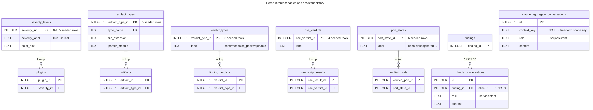
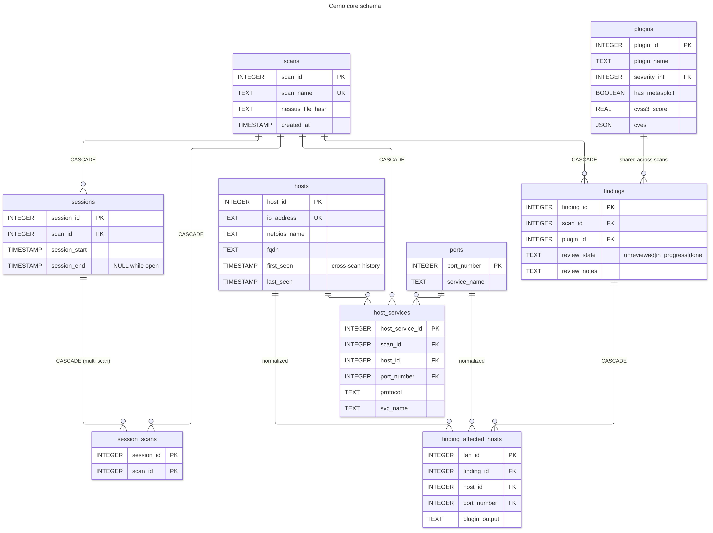
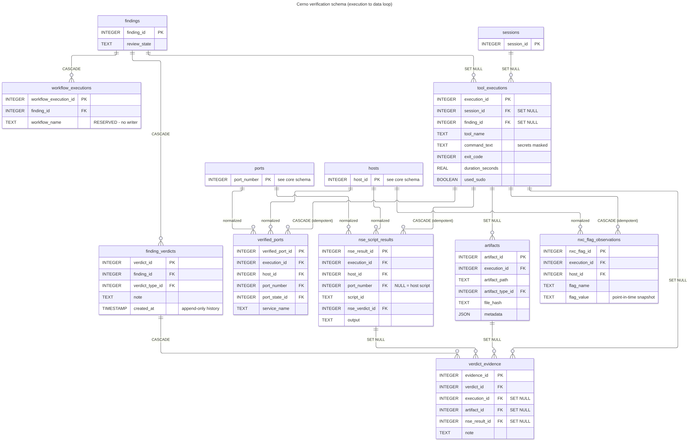

# Cerno Database Documentation

Cerno uses an **integrated SQLite database** with a fully normalized schema for tracking scan metadata, review state, tool executions, and generated artifacts. The database provides an audit trail, enables historical analysis, cross-scan queries, and maintains referential integrity through foreign key constraints.

---

## Table of Contents

- [Overview](#overview)
- [Database Location](#database-location)
- [Normalized Schema Architecture](#normalized-schema-architecture)
- [Schema Overview](#schema-overview)
- [Foundation Tables](#foundation-tables)
- [Core Tables](#core-tables)
- [SQL Views (Computed Statistics)](#sql-views-computed-statistics)
- [Query Examples](#query-examples)
- [Cross-Scan Tracking](#cross-scan-tracking)
- [Schema Reference](#schema-reference)

---

## Overview

The Cerno database tracks:

- **Scans**: Nessus export metadata (scan name, export root, .nessus file hash)
- **Plugins**: Vulnerability definitions (plugin ID, name, severity, CVSS scores, CVEs, Metasploit modules)
- **Findings**: Individual vulnerability findings per scan (review state, append-only review notes)
- **Hosts, Ports & Services**: Normalized host/port data with cross-scan tracking, plus per-scan discovered services
- **Sessions**: Review sessions (start/end; duration via SQL view), including the scans of a multi-scan session
- **Tool Executions & Artifacts**: Commands run (TUI and MCP), their exit codes, and the files they produced
- **Verification results**: Live-verified open ports, NSE script verdicts and NetExec flag snapshots ingested from tool runs
- **Verdicts**: Append-only verification verdicts per finding, with links to the evidence that supports them
- **Claude Assistant history**: Per-finding and scope-level chat turns

All operations work **transparently** - no manual database management required.

---

## Database Location

**Default Path**: `~/.cerno/cerno.db`

The database is global across all scans, enabling cross-scan queries and historical analysis.

**Directory**: `~/.cerno/` is created automatically on first use.

**Schema Version**: 4, stored in `PRAGMA user_version`. There is no migration system: an older database is rejected at startup with `SchemaVersionError`, and you re-import your scans into a fresh one.

---

## Normalized Schema Architecture

Cerno uses a **fully normalized database schema** following relational best practices.

### Key Design Principles

1. **Normalized Lookup Tables**
   - `severity_levels` - Centralized severity reference data
   - `artifact_types` - Standardized artifact type definitions
   - `verdict_types`, `nse_verdicts`, `port_states` - Verification lookup values
   - `hosts` - Deduplicated host data across scans
   - `ports` - Port metadata

2. **Computed Values via Views**
   - Host/port counts computed on-demand via SQL views
   - Session statistics aggregated dynamically
   - No cached or redundant data stored in columns

3. **SQL Views for Statistics**
   - `v_finding_stats` - Host/port counts per finding
   - `v_session_stats` - Session duration and finding counts
   - `v_plugins_with_severity` - Plugins with severity labels
   - `v_host_findings` - Cross-scan host analysis
   - `v_artifacts_with_types` - Artifacts with type names
   - `v_scan_plugin_summary` - Plugin presence per scan with host counts (cross-scan comparison)
   - `v_host_scan_findings` - Per-host vulnerability statistics by scan (host history)
   - `v_http_services` - HTTP/HTTPS services per scan
   - `v_finding_current_verdict` - Latest verification verdict per finding
   - `v_nse_results_with_verdict` - NSE results with their verdict label
   - `v_finding_verified_stats` - Verified port / NSE result counts per finding

4. **Foreign Key Constraints Throughout**
   - All relationships enforced at database level
   - Cascade deletes where appropriate
   - Referential integrity guaranteed

### Benefits

- **Zero Data Redundancy**: Single source of truth for all data
- **Always Accurate**: Computed values never stale
- **Cross-Scan Queries**: Track hosts across multiple scans
- **Data Integrity**: Foreign keys prevent orphaned records
- **Better Performance**: Optimized indexes on all foreign keys

---

## Schema Overview

The database consists of **25 tables** and **11 views**:

### Foundation Tables (Normalized Reference Data)

1. **severity_levels** - Severity definitions (0-4, labels, colors)
2. **artifact_types** - Artifact type definitions
3. **audit_log** - Change tracking (reserved; not yet populated)
4. **verdict_types** - Verification verdict values
5. **nse_verdicts** - NSE vuln-script verdict values
6. **port_states** - nmap port states

### Core Tables

7. **scans** - Top-level scan tracking
8. **plugins** - Plugin metadata (Nessus plugin ID, severity, CVEs)
9. **findings** - Vulnerability findings per scan (review state, notes)
10. **hosts** - Normalized host data (cross-scan tracking)
11. **ports** - Port metadata
12. **finding_affected_hosts** - Host:port combinations per finding (normalized FKs)
13. **host_services** - Services discovered per scan (from Nessus `svc_name`)

### Review & Execution Tracking

14. **sessions** - Review session tracking
15. **session_scans** - Scans included in a (multi-scan) session
16. **tool_executions** - Commands run from the TUI or MCP server
17. **artifacts** - Generated output files
18. **workflow_executions** - Workflow tracking (reserved; not yet populated)

### Verification (Execution → Data Loop)

19. **verified_ports** - Open ports confirmed by an ingested nmap run
20. **nse_script_results** - NSE script output and vuln verdicts from an ingested nmap run
21. **nxc_flag_observations** - NetExec host-flag snapshot from an ingested nxc run
22. **finding_verdicts** - Append-only verification verdicts per finding
23. **verdict_evidence** - Evidence linked to a verdict

### Claude Assistant

24. **claude_conversations** - Per-finding chat history
25. **claude_aggregate_conversations** - Scope-level chat history

### SQL Views (Computed Statistics)

- **v_finding_stats** - Host/port counts per finding (replaces columns)
- **v_session_stats** - Session statistics (replaces columns)
- **v_plugins_with_severity** - Plugins with severity labels (replaces column)
- **v_host_findings** - Cross-scan host analysis
- **v_artifacts_with_types** - Artifacts with type information (replaces column)
- **v_scan_plugin_summary** - Plugin presence per scan with host counts (cross-scan comparison)
- **v_host_scan_findings** - Per-host vulnerability statistics by scan (host history)
- **v_http_services** - HTTP/HTTPS services per scan
- **v_finding_current_verdict** - Latest verdict per finding
- **v_nse_results_with_verdict** - NSE results with verdict labels
- **v_finding_verified_stats** - Verified-fact counts per finding

---

## Foundation Tables

<p align="center">
  <picture>
    <source media="(prefers-color-scheme: dark)" srcset="images/diagrams/05-er-reference-dark.png">
    
  </picture>
</p>

<sub>Lookup tables beside their consumers. <code>audit_log</code> is reserved and stands alone, so it is omitted here. Source: <a href="diagrams/05-er-reference.mmd">docs/diagrams/05-er-reference.mmd</a> — regenerate with <code>./scripts/render_diagrams.sh</code>.</sub>

### severity_levels

Normalized severity reference data - enforces valid severity values.

| Column | Type | Description |
|---|---|---|
| `severity_int` | INTEGER | Primary key (0-4) |
| `severity_label` | TEXT | "Info", "Low", "Medium", "High", "Critical" |
| `severity_order` | INTEGER | Sort order (0-4) |
| `color_hint` | TEXT | Hex color code for UI rendering |

**Pre-populated Data**:
```text
(4, 'Critical', 4, '#8B0000')
(3, 'High', 3, '#FF4500')
(2, 'Medium', 2, '#FFA500')
(1, 'Low', 1, '#FFD700')
(0, 'Info', 0, '#4682B4')
```

**Foreign Keys**: Referenced by `plugins.severity_int`

---

### artifact_types

Artifact type definitions - enforces consistent artifact categorization.

| Column | Type | Description |
|---|---|---|
| `artifact_type_id` | INTEGER | Primary key |
| `type_name` | TEXT | Unique type name |
| `file_extension` | TEXT | Expected file extension |
| `description` | TEXT | Human-readable description |
| `parser_module` | TEXT | Future: Python module for parsing |

**Pre-populated Data**:
- `nmap_xml` - Nmap XML output (.xml)
- `nmap_gnmap` - Nmap greppable output (.gnmap)
- `nmap_nmap` - Nmap normal output (.nmap)
- `netexec_txt` - NetExec text output (.txt)
- `log` - Tool execution log (.log)

**Foreign Keys**: Referenced by `artifacts.artifact_type_id`

---

### audit_log

Audit trail for changes to critical tables. **Reserved:** no triggers or code write to this table yet.

| Column | Type | Description |
|---|---|---|
| `audit_id` | INTEGER | Primary key |
| `table_name` | TEXT | Table being modified |
| `record_id` | INTEGER | Record ID in that table |
| `action` | TEXT | 'INSERT', 'UPDATE', 'DELETE' |
| `changed_by` | TEXT | User identifier (future) |
| `changed_at` | TIMESTAMP | Change timestamp |
| `old_values` | TEXT | JSON of old values |
| `new_values` | TEXT | JSON of new values |

---

### verdict_types, nse_verdicts, port_states

Lookup tables for the verification loop (schema v4). Each has an integer
primary key and a unique `label`; `verdict_types` also has a `description`.

| Table | Seeded labels | Referenced by |
|---|---|---|
| `verdict_types` | `confirmed`, `false_positive`, `unable` | `finding_verdicts.verdict_type_id` |
| `nse_verdicts` | `VULNERABLE`, `NOT_VULNERABLE`, `LIKELY_VULNERABLE`, `UNKNOWN` | `nse_script_results.nse_verdict_id` |
| `port_states` | `open`, `closed`, `filtered`, `open\|filtered`, `closed\|filtered`, `unfiltered` | `verified_ports.port_state_id` |

---

## Core Tables

<p align="center">
  <picture>
    <source media="(prefers-color-scheme: dark)" srcset="images/diagrams/03-er-core-dark.png">
    
  </picture>
</p>

<sub>Core tables. <code>hosts</code> and <code>ports</code> are the cross-scan normalization point. Source: <a href="diagrams/03-er-core.mmd">docs/diagrams/03-er-core.mmd</a> — regenerate with <code>./scripts/render_diagrams.sh</code>.</sub>

### scans

Top-level scan tracking - one row per Nessus export.

| Column | Type | Description |
|---|---|---|
| `scan_id` | INTEGER | Primary key (auto-increment) |
| `scan_name` | TEXT | Unique scan name |
| `nessus_file_path` | TEXT | Original .nessus file path |
| `nessus_file_hash` | TEXT | SHA256 of .nessus file for change detection |
| `export_root` | TEXT | Root directory recorded at import (no files are written there) |
| `created_at` | TIMESTAMP | Scan creation time |
| `last_reviewed_at` | TIMESTAMP | Last review session timestamp |

**Relationships**: One scan has many `findings`, `sessions`, `session_scans` and `host_services` (all CASCADE DELETE)

---

### plugins

Plugin metadata - one row per Nessus plugin ID.

| Column | Type | Description |
|---|---|---|
| `plugin_id` | INTEGER | Primary key - Nessus plugin ID (e.g., 57608) |
| `plugin_name` | TEXT | Plugin name |
| `severity_int` | INTEGER | 0=Info, 1=Low, 2=Medium, 3=High, 4=Critical |
| `has_metasploit` | BOOLEAN | Metasploit module availability |
| `cvss3_score` | REAL | CVSS v3 base score |
| `cvss2_score` | REAL | CVSS v2 base score (fallback) |
| `metasploit_names` | TEXT | JSON array of Metasploit module names |
| `cves` | TEXT | JSON array of CVE IDs |
| `plugin_url` | TEXT | Tenable plugin URL |
| `metadata_fetched_at` | TIMESTAMP | When metadata was last fetched |

**Note**: The `severity_label` is accessed via the `v_plugins_with_severity` view or by JOINing with `severity_levels`.

**Foreign Keys**: `severity_int` → `severity_levels.severity_int`

**Constraints**:
- `CHECK(severity_int BETWEEN 0 AND 4)`

**Note**: "plugin" is internal terminology. User-facing commands use "findings".

**Relationships**: One plugin has many `findings` (across different scans)

---

### hosts

Normalized host data - one row per unique (ip_address, scan_target) combination across ALL scans.

Supports both IP-targeted (internal) and FQDN-targeted (external) scans:
- **IP-targeted scan**: ip_address and scan_target are the same (e.g., `192.168.1.1`)
- **FQDN-targeted scan**: ip_address is the resolved IP, scan_target is the FQDN (e.g., `93.184.216.34` / `example.com`)

| Column | Type | Description |
|---|---|---|
| `host_id` | INTEGER | Primary key |
| `ip_address` | TEXT | Resolved IP address (from Nessus host-ip tag) |
| `scan_target` | TEXT | What was scanned (IP or FQDN from ReportHost@name) |
| `scan_target_type` | TEXT | 'ipv4', 'ipv6', or 'fqdn' |
| `netbios_name` | TEXT | NetBIOS/computer name (from Nessus netbios-name tag) |
| `fqdn` | TEXT | FQDN from Nessus discovery (from host-fqdn tag) |
| `reverse_dns` | TEXT | Reverse DNS result (from host-rdns tag) |
| `first_seen` | TIMESTAMP | First appearance across all scans |
| `last_seen` | TIMESTAMP | Most recent appearance |

**Purpose**: Enables cross-scan host tracking with proper handling of FQDN-targeted external scans and load-balanced hosts.

**Constraints**:
- `UNIQUE(ip_address, scan_target)` - Composite key allows same IP via different targets
- `CHECK(scan_target_type IN ('ipv4', 'ipv6', 'fqdn'))`

**Relationships**: Referenced by `finding_affected_hosts`, `host_services`, `verified_ports`, `nse_script_results` and `nxc_flag_observations` (`host_id`)

---

### ports

Port metadata - one row per port number.

| Column | Type | Description |
|---|---|---|
| `port_number` | INTEGER | Primary key (1-65535) |
| `service_name` | TEXT | Service name, filled from nmap results during ingest (may be NULL) |
| `description` | TEXT | Service description (future) |

**Purpose**: Allows port metadata to be maintained separately from host:port combinations.

**Constraints**:
- `CHECK(port_number BETWEEN 1 AND 65535)`

**Relationships**: Referenced by `finding_affected_hosts`, `host_services`, `verified_ports` and `nse_script_results` (`port_number`)

---

### findings

Finding records - one row per plugin per scan.

| Column | Type | Description |
|---|---|---|
| `finding_id` | INTEGER | Primary key |
| `scan_id` | INTEGER | Foreign key to scans |
| `plugin_id` | INTEGER | Foreign key to plugins |
| `review_state` | TEXT NOT NULL | 'unreviewed' (default), 'in_progress', 'done'. Transitions (unreviewed → in_progress → done → unreviewed) are enforced in the app layer by `Finding.transition_review_state()` |
| `reviewed_at` | TIMESTAMP | Timestamp of the last review-state change |
| `reviewed_by` | TEXT | User tracking (future feature) |
| `review_notes` | TEXT | Append-only, timestamped notes (`Finding.append_note()`, MCP `add_note`, `set_review_state(notes=…)`) |

**Note**: Host and port counts are computed via `v_finding_stats` view rather than stored as columns. File paths are not stored - findings are referenced by IDs.

**Foreign Keys**:
- `scan_id` → `scans.scan_id` (CASCADE DELETE)
- `plugin_id` → `plugins.plugin_id`

**Constraints**:
- `UNIQUE(scan_id, plugin_id)` - One finding per plugin per scan
- `CHECK(review_state IN ('unreviewed', 'in_progress', 'done'))`

**Relationships**: Has many `finding_affected_hosts`, `workflow_executions`, `claude_conversations` and `finding_verdicts` (CASCADE DELETE), and `tool_executions` (SET NULL)

---

### finding_affected_hosts

Host:port combinations per finding using normalized foreign keys.

| Column | Type | Description |
|---|---|---|
| `fah_id` | INTEGER | Primary key |
| `finding_id` | INTEGER | Foreign key to findings |
| `host_id` | INTEGER | Foreign key to normalized hosts table |
| `port_number` | INTEGER | Foreign key to ports table |
| `plugin_output` | TEXT | Plugin output from Nessus scanner |

**Note**: This table uses foreign keys to normalized `hosts` and `ports` tables rather than storing host addresses and port numbers directly. The host type (`ipv4`, `ipv6`, `fqdn`) is stored in the `hosts` table.

**Foreign Keys**:
- `finding_id` → `findings.finding_id` (CASCADE DELETE)
- `host_id` → `hosts.host_id`
- `port_number` → `ports.port_number`

**Constraints**:
- `UNIQUE(finding_id, host_id, port_number)`

**Relationships**: Belongs to one `finding`, one `host`, and optionally one `port`

---

### sessions

Review session tracking.

| Column | Type | Description |
|---|---|---|
| `session_id` | INTEGER | Primary key |
| `scan_id` | INTEGER | Foreign key to scans |
| `session_start` | TIMESTAMP | Session start time |
| `session_end` | TIMESTAMP | Session end time |

**Note**: Session duration and statistics are computed via the `v_session_stats` view rather than stored as columns.

**Foreign Keys**:
- `scan_id` → `scans.scan_id` (CASCADE DELETE). In a multi-scan session this is the primary scan; every scan in the session is listed in `session_scans`.

**Relationships**: Has many `session_scans` (CASCADE DELETE) and `tool_executions` (SET NULL)

---

### session_scans

Junction table recording every scan in a multi-scan review session, so resuming
restores the same set.

| Column | Type | Description |
|---|---|---|
| `session_id` | INTEGER | Foreign key to sessions (CASCADE DELETE) |
| `scan_id` | INTEGER | Foreign key to scans (CASCADE DELETE) |

**Constraints**: `PRIMARY KEY (session_id, scan_id)`

---

### host_services

Services discovered per scan, from the Nessus ReportItem `svc_name`/`protocol`
attributes at import. Feeds `v_http_services` and MCP `list_services`/`get_web_targets`.

| Column | Type | Description |
|---|---|---|
| `host_service_id` | INTEGER | Primary key |
| `scan_id` | INTEGER | Foreign key to scans (CASCADE DELETE) |
| `host_id` | INTEGER | Foreign key to hosts |
| `port_number` | INTEGER | Foreign key to ports |
| `protocol` | TEXT | `tcp` (default) or `udp` |
| `svc_name` | TEXT | Nessus service name (e.g. `www`, `cifs`, `ssh`) |

**Constraints**: `UNIQUE(scan_id, host_id, port_number, protocol)`

---

### tool_executions

Command execution tracking - one row per tool run.

| Column | Type | Description |
|---|---|---|
| `execution_id` | INTEGER | Primary key |
| `session_id` | INTEGER | Foreign key to sessions (NULL if outside session) |
| `finding_id` | INTEGER | Finding the run is attributed to (NULL = unattributed) |
| `tool_name` | TEXT | e.g. 'nmap', 'netexec', 'metasploit', 'custom' (TUI); 'mcp', 'mcp-batch' (MCP runs, unless the client names the tool); 'cred_reveal' (audit-only row for a credential reveal) |
| `tool_protocol` | TEXT | For netexec: 'smb', 'ssh', 'rdp', etc. |
| `command_text` | TEXT | Full command as string |
| `command_args` | TEXT | JSON array of arguments |
| `executed_at` | TIMESTAMP | Execution timestamp |
| `exit_code` | INTEGER | Command exit code |
| `duration_seconds` | REAL | Execution duration |
| `host_count` | INTEGER | Number of hosts targeted |
| `sampled` | BOOLEAN | Was host list sampled (>5 hosts)? |
| `ports` | TEXT | Comma-separated port list |
| `used_sudo` | BOOLEAN | Was sudo used? |

**Foreign Keys**:
- `session_id` → `sessions.session_id` (SET NULL DELETE)
- `finding_id` → `findings.finding_id` (SET NULL DELETE)

**Relationships**: Has many `artifacts` and `verdict_evidence` (SET NULL), and `verified_ports`, `nse_script_results` and `nxc_flag_observations` (CASCADE DELETE)

---

### artifacts

Generated output files - one row per artifact file.

| Column | Type | Description |
|---|---|---|
| `artifact_id` | INTEGER | Primary key |
| `execution_id` | INTEGER | Foreign key to tool_executions |
| `artifact_path` | TEXT | Absolute path (unique) |
| `artifact_type_id` | INTEGER | Foreign key to artifact_types lookup table |
| `file_size_bytes` | INTEGER | File size in bytes |
| `file_hash` | TEXT | SHA256 hash |
| `created_at` | TIMESTAMP | Creation timestamp |
| `last_accessed_at` | TIMESTAMP | Last access time |
| `metadata` | TEXT | JSON metadata (NSE scripts, UDP flag, etc.) |

**Note**: Artifact type names are accessed via the `v_artifacts_with_types` view by JOINing with `artifact_types`.

**Foreign Keys**:
- `execution_id` → `tool_executions.execution_id` (SET NULL DELETE)
- `artifact_type_id` → `artifact_types.artifact_type_id`

**Relationships**: Belongs to one `tool_execution` and one `artifact_type`; referenced by `verdict_evidence.artifact_id` (SET NULL)

---

### workflow_executions

Workflow tracking - one row per workflow execution. **Reserved:** nothing writes to this table yet.

| Column | Type | Description |
|---|---|---|
| `workflow_execution_id` | INTEGER | Primary key |
| `finding_id` | INTEGER | Foreign key to findings |
| `workflow_name` | TEXT | Workflow identifier |
| `executed_at` | TIMESTAMP | Execution timestamp |
| `completed` | BOOLEAN | Completion status |
| `results` | TEXT | JSON results (step outcomes) |

**Foreign Keys**:
- `finding_id` → `findings.finding_id` (CASCADE DELETE)

**Relationships**: Belongs to one `finding`

---

## Verification Tables (Execution → Data Loop)

Added in schema v4. Facts are tied to the tool run that produced them
(`execution_id`), and re-ingesting a run reconciles its rows in place, so
ingestion is idempotent. Ingest is triggered by the MCP `ingest_results` tool, or
automatically after MCP runs when mutations are enabled.

<p align="center">
  <picture>
    <source media="(prefers-color-scheme: dark)" srcset="images/diagrams/04-er-verification-dark.png">
    
  </picture>
</p>

<sub>Verification tables. Delete behaviour is labelled on each relationship. Source: <a href="diagrams/04-er-verification.mmd">docs/diagrams/04-er-verification.mmd</a> — regenerate with <code>./scripts/render_diagrams.sh</code>.</sub>

### verified_ports

Open ports confirmed by an ingested nmap run.

| Column | Type | Description |
|---|---|---|
| `verified_port_id` | INTEGER | Primary key |
| `execution_id` | INTEGER | Foreign key to tool_executions (CASCADE DELETE) |
| `host_id` | INTEGER | Foreign key to hosts |
| `port_number` | INTEGER | Foreign key to ports |
| `protocol` | TEXT | `tcp` (default) or `udp` |
| `port_state_id` | INTEGER | Foreign key to port_states |
| `service_name` | TEXT | Service nmap reported |
| `created_at` | TIMESTAMP | Ingest time |

**Constraints**: `UNIQUE(execution_id, host_id, port_number, protocol)`

### nse_script_results

NSE script output and vuln verdicts from an ingested nmap run.

| Column | Type | Description |
|---|---|---|
| `nse_result_id` | INTEGER | Primary key |
| `execution_id` | INTEGER | Foreign key to tool_executions (CASCADE DELETE) |
| `host_id` | INTEGER | Foreign key to hosts |
| `port_number` | INTEGER | Foreign key to ports (NULL = host script) |
| `script_id` | TEXT | NSE script name |
| `nse_verdict_id` | INTEGER | Foreign key to nse_verdicts |
| `output` | TEXT | Script output |
| `created_at` | TIMESTAMP | Ingest time |

**Constraints**: `UNIQUE(execution_id, host_id, port_number, script_id)`

### nxc_flag_observations

Point-in-time snapshot of NetExec boolean host attributes (signing, SMBv1, DC,
spooler, NLA, …) from an ingested nxc run. Credentials and shares are not copied;
they are read live from the NetExec workspace.

| Column | Type | Description |
|---|---|---|
| `nxc_flag_id` | INTEGER | Primary key |
| `execution_id` | INTEGER | Foreign key to tool_executions (CASCADE DELETE) |
| `host_id` | INTEGER | Foreign key to hosts |
| `protocol` | TEXT | NetExec protocol (e.g. `smb`) |
| `flag_name` | TEXT | Attribute name |
| `flag_value` | INTEGER | `0` or `1` (CHECK) |
| `created_at` | TIMESTAMP | Ingest time |

**Constraints**: `UNIQUE(execution_id, host_id, protocol, flag_name)`

### finding_verdicts

Append-only verification verdicts. The current verdict is the latest
`created_at` (ties broken by the highest `verdict_id`); see
`v_finding_current_verdict`. Separate from `findings.review_state`.

| Column | Type | Description |
|---|---|---|
| `verdict_id` | INTEGER | Primary key |
| `finding_id` | INTEGER | Foreign key to findings (CASCADE DELETE) |
| `verdict_type_id` | INTEGER | Foreign key to verdict_types |
| `note` | TEXT | Optional note |
| `created_at` | TIMESTAMP | When the verdict was recorded |
| `created_by` | TEXT | Optional recorder name (currently NULL for MCP-recorded verdicts) |

### verdict_evidence

Evidence linked to a verdict. Evidence links survive deletion of the underlying
run, artifact or NSE result (SET NULL).

| Column | Type | Description |
|---|---|---|
| `evidence_id` | INTEGER | Primary key |
| `verdict_id` | INTEGER | Foreign key to finding_verdicts (CASCADE DELETE) |
| `execution_id` | INTEGER | Foreign key to tool_executions (SET NULL) |
| `artifact_id` | INTEGER | Foreign key to artifacts (SET NULL) |
| `nse_result_id` | INTEGER | Foreign key to nse_script_results (SET NULL) |
| `note` | TEXT | Optional note |

---

## Claude Assistant Tables

### claude_conversations

Per-finding chat history; one row per turn.

| Column | Type | Description |
|---|---|---|
| `id` | INTEGER | Primary key |
| `finding_id` | INTEGER | Foreign key to findings (CASCADE DELETE) |
| `role` | TEXT | `user` or `assistant` (CHECK) |
| `content` | TEXT | Message text |
| `created_at` | TEXT | Defaults to `datetime('now')` |

### claude_aggregate_conversations

Scope-level chat history (severity menu or filtered findings list). It has no
FK: the scope is identified by `context_key`, e.g. `sev_menu:1,3` (sorted,
comma-joined scan IDs, plus `:<host>` when a host filter is active) or
`findings_list:<scan_ids>:<scope_hash>`.

| Column | Type | Description |
|---|---|---|
| `id` | INTEGER | Primary key |
| `context_key` | TEXT | Scope identifier |
| `role` | TEXT | `user` or `assistant` (CHECK) |
| `content` | TEXT | Message text |
| `created_at` | TEXT | Defaults to `datetime('now')` |

---

## SQL Views (Computed Statistics)

Views provide computed aggregates without storing redundant data. All statistics are computed on-demand from normalized tables.

### v_finding_stats

Replaces `host_count` and `port_count` columns from `findings` table.

**Columns**:
- `finding_id`, `scan_id`, `plugin_id`, `review_state`, `reviewed_at`, `reviewed_by`, `review_notes`
- `host_count` - COUNT(DISTINCT host_id) from finding_affected_hosts
- `port_count` - COUNT(DISTINCT port_number) from finding_affected_hosts

**Usage**:
```sql
SELECT * FROM v_finding_stats WHERE finding_id = 123;
```

---

### v_session_stats

Replaces cached statistics columns from `sessions` table.

**Columns**:
- `session_id`, `scan_id`, `session_start`, `session_end`
- `duration_seconds` - Computed from start/end timestamps
- `files_in_progress` - COUNT findings with review_state='in_progress'
- `files_done` - COUNT findings with review_state='done'

These counts cover findings of the session's own `scan_id` whose `reviewed_at`
falls inside the session window. The other scans of a multi-scan session (in
`session_scans`) are not counted.
- `tools_executed` - COUNT tool executions in session
- `cves_extracted` - COUNT plugins with non-NULL cves

**Usage**:
```sql
SELECT * FROM v_session_stats ORDER BY session_start DESC LIMIT 5;
```

---

### v_plugins_with_severity

Replaces `severity_label` column from `plugins` table - JOINs with `severity_levels`.

**Columns**:
- `plugin_id`, `plugin_name`, `severity_int`
- `severity_label` - From severity_levels table
- `color_hint` - From severity_levels table
- `has_metasploit`, `cvss3_score`, `cvss2_score`, `cves`, `metasploit_names`, `plugin_url`, `metadata_fetched_at`

**Usage**:
```sql
SELECT plugin_name, severity_label, cvss3_score
FROM v_plugins_with_severity
WHERE severity_int >= 3
ORDER BY severity_int DESC, cvss3_score DESC;
```

---

### v_host_findings

Cross-scan host analysis view.

**Columns**:
- `host_id`, `ip_address`, `scan_target`, `scan_target_type`
- `netbios_name`, `fqdn`, `first_seen`, `last_seen`
- `scan_count` - Number of scans this host appeared in
- `finding_count` - Total findings across all scans
- `port_count` - Unique ports across all findings
- `max_severity` - Highest severity finding for this host

**Usage**:
```sql
-- Find hosts that appeared in multiple scans
SELECT ip_address, scan_target, scan_count, finding_count
FROM v_host_findings
WHERE scan_count > 1
ORDER BY scan_count DESC;
```

---

### v_artifacts_with_types

Replaces `artifact_type` TEXT column with JOIN to `artifact_types` table.

**Columns**:
- `artifact_id`, `execution_id`, `artifact_path`
- `artifact_type` - type_name from artifact_types table
- `file_extension`, `artifact_description` - From artifact_types table
- `file_size_bytes`, `file_hash`, `created_at`, `last_accessed_at`, `metadata`

**Usage**:
```sql
SELECT artifact_type, COUNT(*) as count, SUM(file_size_bytes) / 1024.0 / 1024.0 as total_mb
FROM v_artifacts_with_types
GROUP BY artifact_type
ORDER BY total_mb DESC;
```

---

### v_scan_plugin_summary

Plugin presence per scan with affected host counts - used by `cerno scan compare` command.

**Columns**:
- `scan_id`, `scan_name`, `scan_date`
- `plugin_id`, `plugin_name`, `severity_int`, `severity_label`
- `has_metasploit` - Metasploit module availability
- `cvss3_score` - CVSS v3 base score
- `affected_hosts` - COUNT(DISTINCT host_id) for this plugin in this scan
- `affected_ports` - COUNT(DISTINCT port_number) for this plugin in this scan

**Usage**:
```sql
-- Get all Critical plugins in a scan with host counts
SELECT plugin_id, plugin_name, affected_hosts
FROM v_scan_plugin_summary
WHERE scan_id = 1 AND severity_int = 4
ORDER BY affected_hosts DESC;

-- Compare plugin presence between two scans
SELECT
    COALESCE(s1.plugin_id, s2.plugin_id) as plugin_id,
    COALESCE(s1.plugin_name, s2.plugin_name) as plugin_name,
    s1.affected_hosts as scan1_hosts,
    s2.affected_hosts as scan2_hosts
FROM (SELECT * FROM v_scan_plugin_summary WHERE scan_id = 1) s1
FULL OUTER JOIN (SELECT * FROM v_scan_plugin_summary WHERE scan_id = 2) s2
    ON s1.plugin_id = s2.plugin_id;
-- Filter each side in a subquery: a WHERE on s1/s2 after the join would drop
-- the NULL side and hide new/resolved plugins. FULL OUTER JOIN needs SQLite 3.39+.
```

---

### v_host_scan_findings

Per-host vulnerability statistics broken down by scan - used by `cerno scan history` command.

**Columns**:
- `host_id`, `ip_address`, `scan_target`, `scan_target_type`
- `scan_id`, `scan_name`, `scan_date`
- `finding_count` - COUNT(DISTINCT plugin_id) for this host in this scan
- `max_severity` - Highest severity finding
- `critical_count`, `high_count`, `medium_count`, `low_count`, `info_count` - Counts by severity

**Usage**:
```sql
-- Get vulnerability history for a specific host
SELECT scan_name, scan_date, finding_count, max_severity,
       critical_count, high_count, medium_count, low_count, info_count
FROM v_host_scan_findings
WHERE ip_address = '192.168.1.10'
ORDER BY scan_date ASC;

-- Find hosts with improving vulnerability trends
SELECT ip_address, scan_target,
       GROUP_CONCAT(finding_count, ' -> ') as trend
FROM v_host_scan_findings
GROUP BY host_id
HAVING COUNT(*) > 1
ORDER BY ip_address;
```

---

### v_http_services

HTTP/HTTPS services per scan, from `host_services`. A service matches on
`svc_name` (`www`, `http`, `https`, `http?`, `https?`) or on port 80/443/8080/8443.

**Columns**: `host_service_id`, `scan_id`, `host_id`, `scan_target`, `port_number`, `protocol`, `svc_name`, `http_scheme` (`http`/`https`)

---

### v_finding_current_verdict

The latest `finding_verdicts` row per finding, joined to `verdict_types`.

**Columns**: `finding_id`, `verdict_id`, `verdict_type_id`, `verdict_label`, `note`, `created_at`, `created_by`

---

### v_nse_results_with_verdict

`nse_script_results` with the verdict label resolved.

**Columns**: `nse_result_id`, `execution_id`, `host_id`, `port_number`, `script_id`, `nse_verdict_id`, `verdict_label`, `output`, `created_at`

---

### v_finding_verified_stats

Per-finding counts of verified facts, joined through `tool_executions.finding_id`.

**Columns**: `finding_id`, `verified_port_count`, `nse_result_count`, `vulnerable_count` (NSE results with verdict `VULNERABLE`)

```sql
-- Findings with at least one VULNERABLE NSE result, and their current verdict
SELECT s.finding_id, s.vulnerable_count, v.verdict_label
FROM v_finding_verified_stats s
LEFT JOIN v_finding_current_verdict v ON v.finding_id = s.finding_id
WHERE s.vulnerable_count > 0;
```

---

## Query Examples

### Get a Finding with Host/Port Counts

```sql
-- Host/port counts are computed by the view (no stored columns)
SELECT finding_id, scan_id, plugin_id, host_count, port_count
FROM v_finding_stats
WHERE finding_id = 123;
```

---

### Get Plugin with Severity Label

```sql
-- Severity labels come from the severity_levels lookup table
SELECT plugin_id, plugin_name, severity_label, cvss3_score
FROM v_plugins_with_severity
WHERE plugin_id = 57608;
```

---

### Find All Findings for a Specific Host Across All Scans

Enabled by the normalized hosts table:

```sql
SELECT
    h.ip_address,
    h.scan_target,
    s.scan_name,
    s.created_at as scan_date,
    p.plugin_name,
    sl.severity_label,
    f.review_state
FROM hosts h
JOIN finding_affected_hosts fah ON h.host_id = fah.host_id
JOIN findings f ON fah.finding_id = f.finding_id
JOIN plugins p ON f.plugin_id = p.plugin_id
JOIN severity_levels sl ON p.severity_int = sl.severity_int
JOIN scans s ON f.scan_id = s.scan_id
WHERE h.ip_address = '192.168.1.10'
ORDER BY s.created_at DESC, sl.severity_order DESC;
```

---

### Get Hosts that Appeared in Multiple Scans

Using the `v_host_findings` view:

```sql
SELECT
    ip_address,
    scan_target,
    scan_target_type,
    netbios_name,
    scan_count,
    finding_count,
    port_count,
    first_seen,
    last_seen
FROM v_host_findings
WHERE scan_count > 1
ORDER BY scan_count DESC, finding_count DESC;
```

---

### Review Progress Across All Scans

```sql
SELECT
    s.scan_name,
    COUNT(*) as total_files,
    SUM(CASE WHEN f.review_state = 'done' THEN 1 ELSE 0 END) as done,
    SUM(CASE WHEN f.review_state = 'in_progress' THEN 1 ELSE 0 END) as in_progress,
    SUM(CASE WHEN f.review_state = 'unreviewed' THEN 1 ELSE 0 END) as unreviewed,
    ROUND(100.0 * SUM(CASE WHEN f.review_state = 'done' THEN 1 ELSE 0 END) / COUNT(*), 1) as completion_pct
FROM scans s
JOIN findings f ON f.scan_id = s.scan_id
GROUP BY s.scan_name
ORDER BY completion_pct DESC;
```

---

### Find Critical Plugins with Metasploit Modules

```sql
SELECT
    p.plugin_id,
    p.plugin_name,
    sl.severity_label,
    p.cvss3_score,
    p.metasploit_names,
    COUNT(DISTINCT f.scan_id) as scan_count,
    COUNT(DISTINCT h.ip_address) as unique_hosts
FROM plugins p
JOIN severity_levels sl ON p.severity_int = sl.severity_int
JOIN findings f ON f.plugin_id = p.plugin_id
JOIN finding_affected_hosts fah ON fah.finding_id = f.finding_id
JOIN hosts h ON fah.host_id = h.host_id
WHERE p.severity_int = 4  -- Critical
  AND p.has_metasploit = 1
GROUP BY p.plugin_id, p.plugin_name, sl.severity_label, p.cvss3_score, p.metasploit_names
ORDER BY p.cvss3_score DESC, unique_hosts DESC;
```

---

### Session Statistics

```sql
-- Get session statistics with computed values
SELECT
    session_id,
    session_start,
    session_end,
    ROUND(duration_seconds / 60.0, 1) as duration_minutes,
    files_in_progress,
    files_done,
    tools_executed,
    cves_extracted
FROM v_session_stats
ORDER BY session_start DESC
LIMIT 10;
```

---

### Artifact Storage by Type

```sql
SELECT
    artifact_type,
    COUNT(*) as file_count,
    SUM(file_size_bytes) / 1024.0 / 1024.0 as total_mb,
    ROUND(AVG(file_size_bytes) / 1024.0, 1) as avg_kb
FROM v_artifacts_with_types
GROUP BY artifact_type
ORDER BY total_mb DESC;
```

---

## Cross-Scan Tracking

The normalized schema enables powerful cross-scan queries:

### Track Host Appearance History

```sql
-- When did each host first and last appear?
SELECT
    h.ip_address,
    h.scan_target,
    h.netbios_name,
    h.first_seen,
    h.last_seen,
    julianday(h.last_seen) - julianday(h.first_seen) as days_tracked,
    v.scan_count,
    v.finding_count
FROM hosts h
JOIN v_host_findings v ON h.host_id = v.host_id
ORDER BY days_tracked DESC;
```

---

### Compare Host Findings Between Two Scans

```sql
SELECT
    h.ip_address,
    h.scan_target,
    s1_findings.plugin_count as scan1_plugins,
    s2_findings.plugin_count as scan2_plugins,
    CASE
        WHEN s1_findings.plugin_count > s2_findings.plugin_count THEN 'Improved'
        WHEN s1_findings.plugin_count < s2_findings.plugin_count THEN 'Worsened'
        ELSE 'Same'
    END as trend
FROM hosts h
LEFT JOIN (
    SELECT fah.host_id, COUNT(DISTINCT f.plugin_id) as plugin_count
    FROM finding_affected_hosts fah
    JOIN findings f ON fah.finding_id = f.finding_id
    JOIN scans s ON f.scan_id = s.scan_id
    WHERE s.scan_name = 'Scan1'
    GROUP BY fah.host_id
) s1_findings ON h.host_id = s1_findings.host_id
LEFT JOIN (
    SELECT fah.host_id, COUNT(DISTINCT f.plugin_id) as plugin_count
    FROM finding_affected_hosts fah
    JOIN findings f ON fah.finding_id = f.finding_id
    JOIN scans s ON f.scan_id = s.scan_id
    WHERE s.scan_name = 'Scan2'
    GROUP BY fah.host_id
) s2_findings ON h.host_id = s2_findings.host_id
WHERE s1_findings.plugin_count IS NOT NULL
   OR s2_findings.plugin_count IS NOT NULL
ORDER BY ABS(COALESCE(s1_findings.plugin_count, 0) - COALESCE(s2_findings.plugin_count, 0)) DESC;
```

---

### Find New Hosts in Latest Scan

```sql
-- Hosts that appear in latest scan but not in previous scans
SELECT
    h.ip_address,
    h.scan_target,
    h.scan_target_type,
    h.netbios_name,
    COUNT(DISTINCT f.plugin_id) as finding_count,
    MAX(p.severity_int) as max_severity
FROM hosts h
JOIN finding_affected_hosts fah ON h.host_id = fah.host_id
JOIN findings f ON fah.finding_id = f.finding_id
JOIN plugins p ON f.plugin_id = p.plugin_id
WHERE f.scan_id = (SELECT scan_id FROM scans ORDER BY created_at DESC LIMIT 1)
  AND h.host_id NOT IN (
      SELECT DISTINCT fah2.host_id
      FROM finding_affected_hosts fah2
      JOIN findings f2 ON fah2.finding_id = f2.finding_id
      WHERE f2.scan_id != (SELECT scan_id FROM scans ORDER BY created_at DESC LIMIT 1)
  )
GROUP BY h.host_id, h.ip_address, h.scan_target, h.scan_target_type, h.netbios_name
ORDER BY max_severity DESC, finding_count DESC;
```

---

## Schema Reference

Full schema available in [`../schema.sql`](../schema.sql), a reference copy of `cerno_pkg/database.py` (`SCHEMA_SQL_TABLES` + `SCHEMA_SQL_VIEWS`) that a test keeps in sync.

### Database Initialization

The database is initialized automatically on first use. Schema creation is handled by `cerno_pkg/database.py:initialize_database()`.

**Key Points**:
- Schema version: 4, stored in `PRAGMA user_version` (no migration system; an older database raises `SchemaVersionError` at startup and must be deleted and scans re-imported)
- All tables created with `CREATE TABLE IF NOT EXISTS` for idempotency
- Lookup tables pre-populated automatically (`severity_levels`, `artifact_types`, `verdict_types`, `nse_verdicts`, `port_states`)
- Views created after tables
- Foreign key constraints enforced on all connections

### PRAGMA Settings

Applied at connection time for optimal performance:

```sql
PRAGMA journal_mode=WAL;        -- Write-Ahead Logging for concurrency
PRAGMA foreign_keys=ON;         -- Enable referential integrity
PRAGMA synchronous=NORMAL;      -- Balance safety and performance
PRAGMA temp_store=MEMORY;       -- Keep temp tables in memory
PRAGMA cache_size=-64000;       -- 64MB cache
```

### Foreign Key Relationships

Edges without an explicit `ON DELETE` clause use SQLite's default (NO ACTION):
the parent row can't be deleted while it is still referenced.

```
scans
  ├── findings (scan_id) - CASCADE
  ├── sessions (scan_id) - CASCADE
  ├── session_scans (scan_id) - CASCADE
  └── host_services (scan_id) - CASCADE

plugins
  └── findings (plugin_id) - NO ACTION

severity_levels
  └── plugins (severity_int) - NO ACTION

hosts
  └── finding_affected_hosts, host_services, verified_ports,
      nse_script_results, nxc_flag_observations (host_id) - NO ACTION

ports
  └── finding_affected_hosts, host_services, verified_ports,
      nse_script_results (port_number) - NO ACTION

findings
  ├── finding_affected_hosts (finding_id) - CASCADE
  ├── workflow_executions (finding_id) - CASCADE
  ├── claude_conversations (finding_id) - CASCADE
  ├── finding_verdicts (finding_id) - CASCADE
  └── tool_executions (finding_id) - SET NULL

sessions
  ├── session_scans (session_id) - CASCADE
  └── tool_executions (session_id) - SET NULL

tool_executions
  ├── verified_ports (execution_id) - CASCADE
  ├── nse_script_results (execution_id) - CASCADE
  ├── nxc_flag_observations (execution_id) - CASCADE
  ├── artifacts (execution_id) - SET NULL
  └── verdict_evidence (execution_id) - SET NULL

finding_verdicts
  └── verdict_evidence (verdict_id) - CASCADE

artifacts
  └── verdict_evidence (artifact_id) - SET NULL

nse_script_results
  └── verdict_evidence (nse_result_id) - SET NULL

artifact_types / verdict_types / nse_verdicts / port_states
  └── artifacts / finding_verdicts / nse_script_results / verified_ports - NO ACTION
```

**Cascade Rules**:
- Deleting a scan (`cerno scan delete`) removes its findings and, through them, host:port rows, workflow executions, Claude chat history, verdicts and verdict evidence. It also removes the scan's sessions, session_scans and host_services.
- Tool executions and artifacts survive a scan delete: their `finding_id`/`session_id` links are set to NULL, and the verified ports, NSE results and nxc flags hanging off those executions are kept.
- Deleting a tool execution deletes its verified ports, NSE results and nxc flags, and sets `artifacts.execution_id` and `verdict_evidence.execution_id` to NULL.
- Lookup rows (severity levels, artifact/verdict types, NSE verdicts, port states), plugins, hosts and ports can't be deleted while referenced.

---

## Database Maintenance

### Direct Database Access

```bash
# Open database in sqlite3 CLI
sqlite3 ~/.cerno/cerno.db

# Run a query
sqlite3 ~/.cerno/cerno.db "SELECT * FROM v_host_findings LIMIT 10;"

# Export to CSV
sqlite3 -csv ~/.cerno/cerno.db "SELECT * FROM v_session_stats;" > sessions.csv
```

### Health Checks

```bash
# Check database integrity
sqlite3 ~/.cerno/cerno.db "PRAGMA integrity_check;"

# Optimize database (reclaim space)
sqlite3 ~/.cerno/cerno.db "VACUUM;"

# Database statistics
sqlite3 ~/.cerno/cerno.db "
  SELECT
    (page_count * page_size) / 1024.0 / 1024.0 as size_mb
  FROM (
    SELECT (SELECT * FROM pragma_page_count) as page_count,
           (SELECT * FROM pragma_page_size) as page_size
  );
"
```

### Backup Database

```bash
# SQLite backup command (consistent even with WAL mode and an open session)
sqlite3 ~/.cerno/cerno.db ".backup ~/.cerno/cerno.db.backup"
```

---

## Future Enhancements

Planned database features:

- **Enhanced cross-scan analytics**: Trend analysis, risk scoring over time
- **Reverse DNS resolution**: Automatically populate `hosts.reverse_dns`
- **Audit triggers**: Automatically track changes to critical tables
- **Export utilities**: Generate reports from database queries
- **Web UI**: Database-backed web interface for team collaboration

---

**Last Updated**: 2026-10-27 (v2.6.0)
**Maintained By**: Ridgeback InfoSec, LLC
**Schema Version**: 4
